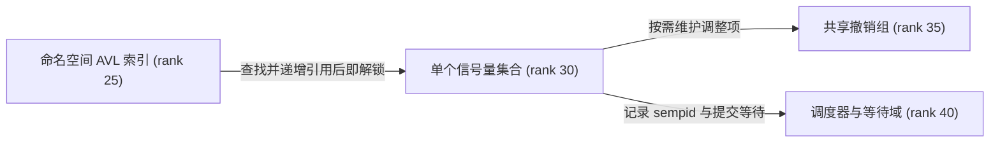

# System V 信号量（SysV SEM）

在操作系统经典并发控制理论中，**信号量（Semaphore）**通过维护非负整数计数器协调多个进程对临界区或有限资源的访问。Linux 提供的 **System V 信号量（System V Semaphore，SysV SEM）**在此基础上进一步支持**信号量集合**（一个对象内打包多个计数器）、**多操作原子提交**（一次传入一组增减或等待零操作，要么全部生效，要么全部回滚阻塞）以及**进程异常退出自动补偿（`SEM_UNDO`）**。本文基于 `include/kernel/sem.h` 与 `kernel/sem.c` 的实际代码，阐述 BoarOS 的每集合细粒度并行设计与内核实现。

---

## 一、源码组织

| 源码路径 | 核心职责 |
| :--- | :--- |
| `include/kernel/ipc.h` | 通用 `struct kernel_ipc64_perm`（48 字节）布局、IPC 常量与基于有效身份/创建者的权限校验 |
| `include/kernel/sem.h` | `kernel_sembuf`（6 字节）、`kernel_semid64_ds`（88 字节）、`kernel_seminfo`（40 字节）布局、限额宏与内核接口 |
| `kernel/sem.c` | 各 IPC 命名空间的 AVL 树索引、每集合独立自旋锁、原子操作回滚、等待队列唤醒、共享撤销组（`SEM_UNDO`）与 `/proc/sysvipc/sem` 枚举 |
| `kernel/syscall/dispatch.c` | 原生 Linux 系统调用号分派：`semget(190)`、`semctl(191)`、`semtimedop(192)`、`semop(193)` |

---

## 二、执行模型、限额与锁层级

与集中于 CPU0 串行处理的传统做法不同，BoarOS 的 SysV 信号量全路径**直接在调用核（发起系统调用的 CPU）并发执行**，无需跨核交接给 CPU0 业务线程：



- **索引与对象解耦**：每个 IPC 命名空间在首次创建集合时按需分配 `struct kernel_sem_table`，使用两棵 AVL 平衡树（`slots` 与 `keys`）分别按槽位号和键值索引集合，并维护 32,000 项 `uint16_t sequence[]` 代次数组。标识符编码为 `id = (seq << 15) | slot`（低 15 位为槽号，高位为代次）。
- **每集合独立保护**：查找并增加集合引用计数后即释放索引锁；不同集合的数值修改、等待排队和撤销记录完全并行，互不争抢锁。
- **默认系统限额**（定义于 `include/kernel/sem.h`）：

| 常量 | 默认值 | 含义 |
| :--- | :--- | :--- |
| `KERNEL_SEMMNI` | 32,000 | 单个 IPC 命名空间最多同时存在的信号量集合数 |
| `KERNEL_SEMMSL` | 32,000 | 单个集合最多包含的信号量计数器数量 |
| `KERNEL_SEMMNS` | 1,024,000,000 | 单个 IPC 命名空间所有集合的计数器总数上限 |
| `KERNEL_SEMOPM` | 500 | 单次 `semop`/`semtimedop` 允许提交的操作数组最大长度 |
| `KERNEL_SEMVMX` | 32,767 | 单个信号量计数器的允许最大值（合法区间 `0 ～ 32,767`） |
| `KERNEL_SEMAEM` | 32,767 | 单个信号量的 `SEM_UNDO` 调整值上限（合法区间 `-32,768 ～ 32,767`） |

---

## 三、多操作原子提交与阻塞唤醒

`semop(193)` 与带相对超时参数的 `semtimedop(192)` 共用 `kernel_sem_op()` 实现（musl 直接调用 `semop`，glibc 将 `semop` 路由至 `semtimedop`）。

### 3.1 零前缀泄漏的原子尝试与逆序回滚

用户传入的 `struct kernel_sembuf` 数组只从用户态拷贝一次，即使数组中多次引用同一信号量索引，也严格按顺序求值。在持集合锁执行 `request_try()` 时：
1. 顺序遍历数组中的每条操作：
   - `sem_op > 0`：累加计数（超过 `KERNEL_SEMVMX` 返回 `-ERANGE`）；
   - `sem_op < 0`：尝试扣减（结果小于 0 时，带 `IPC_NOWAIT` 返回 `-EAGAIN`，否则记录当前阻塞下标 `request->blocking` 并转入等待）；
   - `sem_op == 0`：等待计数器归零（当前值非零时同理返回 `-EAGAIN` 或转入等待）。
   - 若操作带有 `SEM_UNDO`，同步预更新反向调整值 `adjustment[sem_num] -= sem_op`（越界返回 `-ERANGE`）。
2. **失败回滚**：只要中途任一条操作阻塞或出错，立即按**逆序**把已修改的前缀计数器与撤销调整值逐一恢复原状，避免分配额外影子数组，也不发生二次扫描。
3. **成功发布**：仅当整组操作全部满足时，才在等待域锁下更新每个被操作成员的最后操作进程号（`sempid`，取调用者线程组 TGID）并刷新集合操作时间戳 `otime`。

### 3.2 阻塞排队、唤醒重扫与终态同步

- 当操作需要阻塞时，请求节点 `struct kernel_sem_request` 挂载到集合等待链尾部并登记到当前任务的 `task->sem_request`，随后释放集合锁休眠。
- 每当有其他进程通过 `semop` 增加/修改计数、`SETVAL`/`SETALL` 改值或退出应用 `SEM_UNDO` 补偿时，`set_update()` 重新扫描等待队列：只要队中某个修改型请求成功推进，便回到队首重新扫描，确保先被满足的靠后请求能进一步解开更早的等待者。
- **锁外唤醒与防重入**：完成、超时（`-EAGAIN`）、信号中断（`-EINTR`，按 Linux 语义不自动重启）以及集合删除（`-EIDRM`）共用同一终态结果字段；`request_complete()` 在集合锁内摘链、固定任务与请求引用，待释放集合锁后再调用 `wake_requests()` 触发调度器唤醒，防止持自旋锁发生跨核唤醒或与远端任务退出产生悬空引用。

---

## 四、`SEM_UNDO` 共享撤销组与进程退出补偿

为了避免持有信号量的进程异常崩溃后永久死锁其他等待者，SysV 信号量支持 `SEM_UNDO` 标志：内核自动记录进程对每个信号量所做净改动的相反数，并在进程退出时反向回补。

- **按需共享组（`struct kernel_sem_undo`）**：撤销记录按“共享撤销组 × 信号量集合”双向链入（`struct sem_undo_entry`）。
  - 带 `CLONE_SYSVSEM` 标志创建线程或子进程时，`kernel_sem_clone()` 在子任务对外发布前递增共享组引用（即使父线程尚未产生任何撤销记录，也会预先创建空组以建立共享关系）。
  - 普通 `fork`（不带 `CLONE_SYSVSEM`）不继承父进程的撤销调整；`execve` 保留执行线程自身的撤销组（非主线程 `execve` 仅接管进程身份，不接管旧组长的撤销组）。
- **退出补偿与 `SETVAL`/`SETALL`/`IPC_RMID` 交互**：
  - 当共享撤销组的最后一个持有者退出时，`kernel_sem_exit()` 遍历组内所有存活集合，将各项调整值叠加回计数器并截断至 `[0, 32,767]`，更新 `sempid` 与 `otime` 后触发等待队列唤醒，最后才释放组内存并对外发布进程退出状态。
  - `SETVAL` 清零所有撤销组对目标成员的调整，`SETALL` 清零整个集合的全部撤销调整；`IPC_RMID` 在锁序 `set(30) -> group(35)` 下将集合从所有撤销组摘除，确保集合销毁与最后共享者退出并发交错时既不泄漏也不重复补偿。

---

## 五、控制命令（`semctl`）与观测视图

`kernel_sem_ctl()` 兼容 `IPC_64` 标志位并支持全部标准控制命令：

| 类别 | 支持命令 | 核心行为 |
| :--- | :--- | :--- |
| 管理与属性 | `IPC_SET`、`IPC_RMID` | 要求所有者、创建者或 `CAP_SYS_ADMIN`；`IPC_RMID` 立即摘除索引、递增槽代次并以 `-EIDRM` 唤醒所有等待者 |
| 状态查询 | `IPC_STAT`、`SEM_STAT`、`SEM_STAT_ANY`、`IPC_INFO`、`SEM_INFO` | 持集合锁抓取快照并归还集合引用后再拷贝到用户态；`INFO` 返回真实限额与当前活跃集合/成员数及最大活跃槽号 |
| 读写数值 | `GETVAL`、`SETVAL`、`GETALL`、`SETALL` | `GETALL`/`SETALL` 将数组托管在任务请求缓冲中，避免把大数组（最高 32,000 项）压入内核栈 |
| 调度与等待观测 | `GETPID`、`GETNCNT`、`GETZCNT` | 分别返回成员最后操作 TGID、当前因该成员负操作阻塞的请求数、因该成员等待零阻塞的请求数 |

`/proc/sysvipc/sem` 通过 `kernel_sem_proc_next()` 直接遍历命名空间 AVL 槽位树，与 `semctl` 共用同一描述符生成路径；跨命名空间隔离规则见 [IPC 命名空间](ipc-namespace.md) 与 [procfs 模块](procfs.md)。

---

<details>
<summary>展开查看：细节契约与定向验证入口</summary>

### 关键细节与清理契约

- **参数与位宽语义**：64 位系统调用参数 `nsops` 遵循 Linux 源码按 `unsigned int` 截断语义；集合创建后持续存活至 `IPC_RMID`，普通进程退出不会自动销毁无主集合。
- **中途失败与强制退出回收**：`semop` 与 `GETALL`/`SETALL` 在内存分配或用户拷贝阶段若遭遇致命信号或任务异常终止，`kernel_sem_abort()` 会清理挂载在 `task->sem_request` 上的未完成请求与临时缓冲，确保无泄漏。所有堆分配、最后一次 `set_put()` 释放与用户态拷贝均在自旋锁之外完成。
- **当前边界**：运行时可写 IPC sysctl 参数接口尚未提供，限额采用编译期默认上限。

### 定向验证入口

```sh
# 宿主 4/16 KiB 页配置下的真实集合并发、回滚、配额与 RMID/退出交错测试
sh tests/host/sem.sh

# 4 核用户态 ABI、musl/glibc、fork/exec/退出补偿与多核并行测试
python3 tests/userland/run.py --workload sysv_sem --only boaros --cpus 4 --memory 512M \
  --kernel build/riscv-user-smp4/kernel-rv --output build/sem-rv4

# 真实 BusyBox syslogd/logread/logger 共享内存 + SEM_UNDO 日志端到端验证（RV64 / LA64）
python3 tests/userland/sysv-log.py --arch riscv --output build/sem-log-rv
python3 tests/userland/sysv-log.py --arch loongarch --output build/sem-log-la
```

</details>
