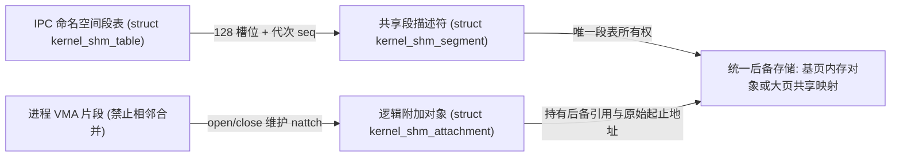

# System V 共享内存（SysV SHM）

共享内存是操作系统中最快的**进程间通信（Inter-Process Communication，IPC）**机制：多个进程把内核维护的同一组物理页同时映射到各自的虚拟地址空间后，无需再经过内核拷贝即可直接通过内存读写交换数据。在 Linux 系统中，传统 **System V 共享内存（System V Shared Memory，SysV SHM）**通过 `shmget`（194）、`shmctl`（195）、`shmat`（196）与 `shmdt`（197）四个系统调用管理生命周期独立于进程的共享段。本文基于 `include/kernel/shm.h`、`mm/shm.c`、`kernel/syscall/shm.c` 与虚拟内存管理代码的实际实现，说明 BoarOS 的共享内存对象模型、延迟销毁、大页支持与限额机制。

---

## 一、源码组织

| 源码路径 | 核心职责 |
| :--- | :--- |
| `include/kernel/ipc.h` | 共享内存、信号量与消息队列共用的 `struct kernel_ipc64_perm`（48 字节）、IPC 常量及通用访问权限判断 |
| `include/kernel/shm.h` | Linux 原生 64 位布局（`kernel_shmid64_ds` 112 字节、`kernel_shminfo64` 72 字节、`kernel_shm_info` 48 字节）、限额宏与内核段/附加结构定义 |
| `mm/shm.c` | 各 IPC 命名空间的共享段表、命名键值（`key`）与私有段（`IPC_PRIVATE`）分配、代次编码、延迟销毁（`IPC_RMID`）与 `nattch` 计数 |
| `kernel/syscall/shm.c` | 系统调用入口包装与参数解码，在 CPU0 服务域内分派至 `kernel_shm_get/ctl/at/dt` |
| `mm/vma.c`、`mm/mm.c` | `KERNEL_VMA_KIND_SYSV_SHM` / `KERNEL_VMA_KIND_HUGETLB_SHARED` 虚拟内存区域（Virtual Memory Area，VMA）管理、按需缺页、不合并约束、`fork` 继承与撤销钩子 |

---

## 二、核心对象模型与映射关系

SysV SHM 的生命周期与进程虚拟映射解耦：一个共享段即使当前没有任何进程映射，也仍保留在所属 IPC 命名空间的段表中并保存数据，直到被显式标记删除（`IPC_RMID`）且最后一个使用者退出或解除映射。

### 2.1 三层所有权设计

1. **段表与后备存储**：
   - 每个 IPC 命名空间在首次创建共享段时按需分配一张 `struct kernel_shm_table`，固定包含 `KERNEL_SHMMNI`（128）个段槽位。
   - **普通页段**使用 `struct kernel_memory_object` 作为稀疏物理页后备；**大页段**（`SHM_HUGETLB`）使用 `struct kernel_hugetlb_map` 的共享后备，直接复用真实高阶物理页与页中间目录（Page Middle Directory，PMD）大页表项，两者均按需缺页分配物理页。
2. **逻辑附加对象（`struct kernel_shm_attachment`）与 VMA 片段**：
   - 进程每次调用 `shmat` 成功时，会创建一个稳定的逻辑附加对象，记录该次附加的原始起止虚拟地址（`start`、`end`）、固定 `shmid`、所属命名空间以及后备对象引用。
   - 同一段附加区域若因后续 `mprotect`、`munmap` 被**分裂（split）**成多个 VMA 片段，所有片段仍共享同一个 `kernel_shm_attachment`。`mm/vma.c` 的 `can_merge()` 明确禁止合并携带 SHM 附加对象的 VMA，防止相邻两次独立附加混为一谈。
   - `shm_nattch` 严格统计**已提交的 VMA 片段数**（而不是进程数）：每次 VMA 插入、分裂或 `fork` 继承时调用 `kernel_shm_attachment_open()` 递增 `nattch`；每次 `shmdt`、`munmap`、进程退出或 `execve` 撤销 VMA 时调用 `kernel_shm_attachment_close_for_task()` 递减 `nattch`。临时筹备中的附加对象只递增 `segment->attachments` 以保住段槽位，不虚增用户可见的 `nattch`。
3. **代次隔离与防悬空引用**：
   - 每个槽位维护单调递增的 16 位代次 `seq`（初值为 1，回绕时跳过 0），公开给用户态的标识符编码为：
     `shmid = slot_idx + seq * KERNEL_SHMMNI`
   - 当共享段彻底销毁时递增该槽位的 `seq`，避免旧进程手持的历史 `shmid` 误命中之后复用的同一槽位。

---

## 三、完整生命周期与延迟销毁（`IPC_RMID`）

- **创建与按需查找（`shmget`）**：
  - `key == IPC_PRIVATE`（0）直接创建全新的私有段；命名键值先扫描活跃且未标记删除的段——若命中则依次校验 `IPC_CREAT | IPC_EXCL` 冲突、请求大小不超过原段（`size == 0` 合法，可用于仅查找已有段）以及读写执行权限位。
  - 若命名键值不存在且未指定 `IPC_CREAT` 返回 `-ENOENT`；新建段时校验长度位于 `[KERNEL_SHMMIN, KERNEL_SHMMAX]`（1 字节 ～ 1 GiB），并受限于所属命名空间的页数总额度 `KERNEL_SHMALL`（按 4 KiB 基页计 262,144 页，计费时将用户请求长度向上取整到架构基页）。
- **延迟销毁语义（`shmctl(IPC_RMID)`）**：
  - 仅允许段所有者（`uid`）、创建者（`cuid`）或具备 `CAP_SYS_ADMIN` 能力的进程删除。
  - 若此时 `nattch == 0` 且 `attachments == 0`，内核立即释放后备物理页、归还锁页配额与 `SHMALL` 统计并递增 `seq` 复位槽位。
  - 若仍有进程映射着该段，内核仅置位 `marked_for_deletion = 1` 并将段键重置为 `IPC_PRIVATE`：后续 `shmget` 无法再按原键值找到它，但已存在的映射保持有效；在段彻底释放前，按完整 `shmid` 的 `shmat` 仍允许重新附加，`IPC_STAT` 与 `/proc/sysvipc/shm` 也在 `mode` 中携带 `SHM_DEST`（`01000`）标志位。直至最后一个 VMA 片段与临时附加持有者释放时，才触发彻底销毁。
- **解除附加（`shmdt`）与部分映射保护**：
  - `shmdt(shmaddr)` 按原始附加起始地址查找对应的 `kernel_shm_attachment`，即使该次附加的首段 VMA 已被 `munmap` 挖空，仍能精准移除同一逻辑附加遗留的全部片段，且不会误伤空洞内后来被匿名映射、文件映射或其他 SHM 附加占据的新 VMA。

---

## 四、大页共享段与权限、锁页控制

### 4.1 原生大页共享内存（`SHM_HUGETLB`）

- **尺寸与权限**：支持架构原生大页（RISC-V 为 2 MiB，LoongArch 为 32 MiB）；通过 `SHM_HUGE_SHIFT`（位偏移 26）可指定默认或原生大页尺寸，其他尺寸返回 `-EINVAL`。创建大页段要求调用者具备 `CAP_IPC_LOCK` 能力或属于 root 组（对应 Linux 初始 `hugetlb_shm_group = 0`）。
- **预留与按需缺页**：后备容量向上取整到原生大页边界，而 `IPC_STAT.shm_segsz` 保持用户原始请求字节数。`shmget` 阶段即从大页池一次性预留所需大页（不足返回 `-ENOMEM`），后续 `shmat` 与 `fork` 不重复预留；指定 `SHM_NORESERVE` 时跳过预留，但实际缺页时若池已耗尽则向进程投递 `SIGBUS`。
- **对齐与控制边界**：`SHM_RND` 按架构基页向下取整，固定地址附加和大页 `mprotect`/`munmap` 均要求满足大页边界对齐。大页本身不可换出，因此 `SHM_LOCK`/`SHM_UNLOCK` 校验权限与 `RLIMIT_MEMLOCK` 后直接返回成功，不占用用户锁页配额也不设置 `SHM_LOCKED`。

### 4.2 权限、控制命令与观测

| 命令 | 权限要求 | 语义说明 |
| :--- | :--- | :--- |
| `IPC_STAT` / `SHM_STAT` / `SHM_STAT_ANY` | 前两者要求读权限或 `CAP_IPC_OWNER`；`SHM_STAT_ANY` 允许全局枚举 | `IPC_STAT` 按完整 `shmid` 查询；`SHM_STAT*` 按槽索引查询并返回带代次的完整 `shmid` |
| `IPC_SET` | 所有者、创建者或 `CAP_SYS_ADMIN` | 先完整从用户态导入 `shmid64_ds`，再更新 `uid`/`gid`/`mode`（已标记删除返回 `-EIDRM`） |
| `IPC_INFO` / `SHM_INFO` | 无额外权限要求 | 分别返回配置上限（`shminfo64`）与实时统计（活跃段数、请求总页数、已驻留页数），返回值为最高活跃槽号（空表为 0） |
| `SHM_LOCK` / `SHM_UNLOCK` | 所有者、创建者或 `CAP_IPC_LOCK` | 普通段按真实用户标识（UID）账户计入 `RLIMIT_MEMLOCK` 锁页额度并在 `mode` 中设置 `SHM_LOCKED`（`02000`），销毁时自动归还 |

- **只读附加与权限上限**：以 `SHM_RDONLY` 附加的 VMA 权限上限锁定为 `RX`，禁止后续 `mprotect` 提升写权限，但允许先降为 `PROT_NONE` 再恢复只读，分裂与 `fork` 均保留该上限。
- **跨命名空间与 procfs 视图**：创建者与最后操作者进程号（`cpid`/`lpid`）内部保存规范的线程组标识（Thread Group ID，TGID）内核引用，系统调用按读取者当前 PID 命名空间转换，`/proc/sysvipc/shm` 按文件打开时捕获的 PID 与 IPC 命名空间输出。详见 [IPC 命名空间](ipc-namespace.md)、[PID 命名空间](pid-namespace.md) 与 [procfs 模块](procfs.md)。

---

展开查看：细节契约与定向验证入口

### 并发、锁外拷贝与边界契约

- **段表快照与锁外用户拷贝**：查询类 `shmctl` 与 `/proc/sysvipc/shm` 在 CPU0 局部中断保护下抓取有界结构快照后即刻退出保护，随后再向用户空间拷贝；拷贝期间原段被删除不影响本次快照，短拷贝返回 `-EFAULT`。
- **任务归属与 `fork` 规则**：共享地址空间（多线程）在非最后引用退出时不改写 `lpid`；异步地址空间回收显式传递实际操作任务而非后台回收线程。`fork` 仅为继承的 VMA 增加引用（带 `MADV_DONTFORK` 的片段直接跳过且不对父页表施加写时复制），遇到内存不足时通过统一销毁钩子回滚。
- **锁页账户归属**：`SHM_LOCK` 扣除锁定时调用者真实 UID 账户的锁页配额；后续 `IPC_SET` 修改段所有者或进程切换 UID 均不转移已接纳的额度，直至 `SHM_UNLOCK` 或段销毁时归还给原账户（详见 [虚拟内存管理](kernel-mm.md)）。
- **暂不支持项**：大页 `mremap`、`MADV_REMOVE`、可写 `hugetlb_shm_group` 系统控制参数、透明大页与独立 `hugetlbfs` 挂载尚未实现。

### 定向验证入口

- **宿主大页与锁页回归**：`tests/host/shm-hugetlb.sh`（覆盖高阶物理页、多附加、`SHM_REMAP`、`fork`、`IPC_RMID`、只读权限、`SHM_NORESERVE` 与配额回收）、`tests/host/shm-lock.sh`。
- **用户态大页与查询测试**：`tests/userland/hugetlb.py`、`tests/workloads/resource/shm_query.c`。
- **Linux 差分 ABI 与真实用户态验证**：`make test-diff-abi-riscv`（`tests/diff-abi/shm.c`）、`make test-userland-riscv`（`tests/userland/sysv_shm.h`）、`make test-stack-usage`。

