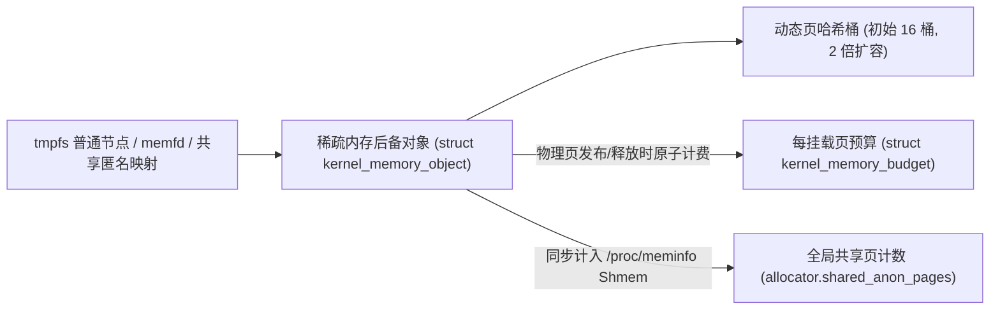

# 内存文件系统（tmpfs）、内存后备对象与 `memfd`

在操作系统中，**临时文件系统（Temporary File System，tmpfs）**将文件数据直接存放在物理内存页缓存中而不绑定任何块设备，常用于临时目录、POSIX 共享内存（`/dev/shm`）以及无需落盘的高速中间产物存储。BoarOS 在 `mm/memory_object.c` 与 `fs/tmpfs.c` 中实现了稀疏内存后备对象与完整的 `tmpfs` 文件系统，并复用同一基础设施支撑匿名共享映射、**匿名内存文件（`memfd_create`）与文件密封（File Sealing）**，以及内核设备文件系统 **`devtmpfs`**。

---

## 一、源码组织

| 源码路径 | 核心职责 |
| :--- | :--- |
| `mm/memory_object.c` | 稀疏内存后备对象（`struct kernel_memory_object`）：按需页哈希桶、原子配额计费、截断/打洞释放与映射追踪 |
| `fs/tmpfs.c` | `tmpfs` VFS 后端：红黑树节点与目录项索引、挂载配额解析、POSIX 访问控制列表（ACL）、扩展属性、`O_TMPFILE`、匿名 `memfd` 及 `devtmpfs` |
| `include/kernel/tmpfs.h` | `tmpfs` 挂载、参数校验、`memfd` 创建、文件密封与 `devtmpfs` 生命周期声明 |
| `fs/open_file.c`、`mm/mm.c` | 内存文件与虚拟地址空间的共享/写时复制（CoW）缺页绑定与映射失效联动 |

---

## 二、稀疏内存后备对象与数据所有权

BoarOS 让共享匿名映射（`MAP_SHARED | MAP_ANONYMOUS`）、SysV 普通共享段与 `tmpfs` 普通文件共享同一套底层容器 **`struct kernel_memory_object`**，彻底消除磁盘页缓存与内存文件之间的双份拷贝。



### 2.1 按需分配与精确计费

- **稀疏空洞零开销**：`find_page` 只查找已驻留物理页。对未写入空洞执行 `read`/`pread`/`readv` 直接向用户缓冲区填零，不分配物理页也不扣除配额；只有实际写入或内存映射缺页时才按需实例化物理页。
- **不重复记账的所有权模型**：后备对象对每张驻留物理页持有一份所有权引用，并在页首次发布时原子扣除挂载页预算（`budget->used`）与全局共享页计数（`allocator->shared_anon_pages`）。页表项（PTE）、`fork` 子进程别名及临时 I/O 固定借用（pin）只增减物理页引用计数，不重复消耗配额。
- **内存统计与不可驱逐性**：驻留页在 `/proc/meminfo` 中计入 `Shmem` 并包含于 `Cached`；由于当前无交换分区（swap），这些页不可作为干净磁盘页被回收，不计入 `MemAvailable` 的文件可回收估算，也不进入磁盘 `Dirty`/`Writeback`。`st_blocks` 遵循 POSIX ABI，始终以 512 字节为单位（`驻留页数 × (PAGE_SIZE / 512)`），在 4 KiB（RISC-V）与 16 KiB（LoongArch）页配置下保持一致。

### 2.2 截断、打洞与写时复制隔离

- **截断（`truncate`）**：先撤销所有虚拟地址空间（MM）中越界的共享与私有写时复制映射，再释放后备对象中越界的物理页并将新文件尾所在页的残余字节清零。各进程已分离的私有写时复制副本属于进程自身 MM，尾页清零不会污染独立私有副本。
- **文件打洞（`fallocate(FALLOC_FL_PUNCH_HOLE | FALLOC_FL_KEEP_SIZE)`）**：复用映射失效流程，彻底释放打洞区间内覆盖的完整物理页并退还页配额，对首尾部分覆盖页仅清零落入区间内的字节；文件逻辑长度保持不变。`MADV_REMOVE` 共享同一底层释放路径（详见 [虚拟内存管理](kernel-mm.md)）。预分配模式当前返回 `-EOPNOTSUPP`。

---

## 三、`tmpfs` 索引结构、挂载选项与安全属性

### 3.1 O(log N) 红黑树索引与目录语义

每个 `tmpfs` 挂载实例（`struct tmp_mount`）完全独立，拥有各自的节点预算、页预算与三类红黑树索引：
- **全局节点树（`m->inodes`）**：按 `inode` 编号索引全挂载存活节点，查找复杂度为 `O(log I)`。
- **每目录双索引（`names` 与 `cookies`）**：每个目录分别维护按名称排序与按单调递增 `cookie` 排序的两棵红黑树，名称查找与 `getdents64` 续读定位均为 `O(log D)`，遍历某个目录不会扫描其他目录。目录大小按 Linux `BOGO_DIRENT_SIZE`（`TMPFS_DIRENT_SIZE = 20` 字节）随目录项增减实时维护。
- **节点类型全覆盖**：
  - 支持普通文件、目录、硬链接（共享节点、链接数、锁与扩展属性，额外硬链接受节点预算约束）、`O_TMPFILE` 匿名临时文件与延迟链接（`link_tmpfile`）、文件导出句柄（用于 `fanotify` 与 `name_to_handle_at`）；
  - 短符号链接存放在节点堆内存中，长符号链接存入计费的后备页；
  - 命名管道（FIFO）与字符/块设备节点（`mknod`）保留真实 `rdev` 与节点配额，但不创建稀疏数据对象（详见 [文件描述符与通用 I/O 层](kernel-files.md)）。

### 3.2 挂载选项与容量边界

用户态自行创建挂载点并调用 `mount("none", target, "tmpfs", flags, options)`，内核不会隐式覆盖 `/tmp` 或 `/dev/shm`。支持的挂载参数严格按 Linux `memparse` 规则（基数 0、`K/M/G/T/P/E` 后缀、百分比与后项覆盖前项）解析：

| 参数 | 默认值 | 含义 |
| :--- | :--- | :--- |
| `size` | 受管物理内存的一半 | 容量上限（字节或百分比，换算为页数）；设为 `0` 取消显式页限额 |
| `nr_blocks` | 受管物理页数的一半 | 直接以架构页数为单位设置容量上限；`0` 表示取消显式限额 |
| `nr_inodes` | 同默认页数上限 | 最大节点（`inode`）数量；`0` 表示取消显式限额 |
| `mode` | `01777` | 根目录八进制权限位（含粘滞位），属主取挂载者 `fsuid`/`fsgid` |

当页或节点预算耗尽时返回 `-ENOSPC`（已写入的前缀仍返回进展），底层物理内存枯竭时返回 `-ENOMEM`；对映射区超过文件尾或页预算耗尽的缺页向用户进程投递 `SIGBUS`。`fsync`/`fdatasync`/`msync` 按内存文件契约立即成功，不提交磁盘 I/O。

### 3.3 扩展属性、POSIX ACL 与文件标志

- **扩展属性与文件能力（`xattr`）**：每个节点维护不可变名称/值记录链（过滤非特权用户的 `trusted.*` 枚举），并对 `security.capability` 保留直达指针 `i->capability`，无扩展属性时普通写入仅做空指针判断；`chown`、写入与截断按统一权限规则剥离特权位与能力。
- **POSIX 访问控制列表（POSIX ACL）**：支持 `system.posix_acl_access` 与 `system.posix_acl_default`；目录设置默认 ACL 后，新建子文件与子目录自动继承并结合 `mode` 计算最终权限，`acl_permission` 在权限校验时结合扩展 ACL 条目裁决。
- **节点标志与所有权**：支持 `FS_IMMUTABLE_FL`、`FS_APPEND_FL`、`FS_NODUMP_FL`（子项继承父目录 `nodump` 位）。遵循 Linux `shmem` 语义：文件被设为不可变（immutable）前已打开的可写描述符与既有共享映射仍可写入；追加模式（append）禁止经可写描述符建立新的共享映射。

---

## 四、`memfd_create`、文件密封与 `devtmpfs`

`fs/tmpfs.c` 将同一套内存文件机制复用到两个核心 Linux 内核特性中：

1. **匿名内存文件（`memfd_create`）与文件密封（File Sealing）**：
   - `kernel_tmpfs_memfd()` 在内核私有、无挂载路径且无显式配额限制的隐藏实例 `memfd_mount` 中创建匿名内存文件并附着虚拟路径名，进程间可通过 Unix 域套接字（`SCM_RIGHTS`）安全传递内存缓冲。
   - `kernel_tmpfs_file_seals()` 实现 `fcntl(F_GET_SEALS / F_ADD_SEALS)`：支持 `F_SEAL_SEAL`（锁定密封集）、`F_SEAL_SHRINK`、`F_SEAL_GROW`、`F_SEAL_WRITE`（若存在活跃可写共享映射则返回 `-EBUSY`）、`F_SEAL_FUTURE_WRITE` 以及配合 `MFD_NOEXEC_SEAL` 的 `F_SEAL_EXEC`（锁定执行权限位）。
2. **动态设备文件系统（`devtmpfs`）**：
   - `kernel_devtmpfs_mount()` 懒初始化一个隐藏可写的共享 `tmpfs` 实例（根权限 `0755`），每次挂载 `/dev` 时仅克隆其挂载视图（即使所有用户挂载均被卸载，共享实例仍保留至系统关机）。
   - 初始化时按已注册字符设备自动创建 `null`、`zero`、`full`、`random`、`urandom`、`console`、`tty`、`ttyS0`、`ptmx`、`rtc0`、`loop-control`，并通过 `kernel_block_set_devnode_publisher()` 订阅块设备热插拔回调，在块设备（含分区与 loop 设备）注册/注销时自动创建或清理对应块设备节点（若用户态已手动替换同名节点则保留用户版本）。

---

<details>
<summary>展开查看：锁序、时间戳语义与定向验证入口</summary>

### 并发锁序、时间戳与当前边界

- **锁层级**：VFS 挂载重配置锁（rank 19）→ 命名空间锁（rank 20）→ 内存对象变更锁 `mutation`（rank 20）→ VFS `inode` 锁（rank 30）→ 内存对象索引锁 `lock`（rank 35）。内存对象物理页分配严格禁止递归进入可睡眠的脏页回收路径。
- **共享映射时间戳语义**：共享映射首次写缺页在发布 PTE 后，通过 `inode` 元数据短自旋锁更新 `mtime`/`ctime`，不升级缺页持有的 `inode` 读锁；私有写时复制不更新文件时间。遵循 Linux `shmem` 无 `page_mkwrite` 回调的语义，读缺页可直接发布可写 PTE，后续普通写入不保证再次触发时间更新。
- **当前边界**：`tmpfs` 后端尚未提供 `remount` 参数重配置回调及交换空间（swap）换出支持；通用挂载传播、绑定挂载（bind）与卸载语义由 [VFS 层](vfs-ext4.md) 统一提供。

### 定向验证入口

```sh
# 内存对象与文件映射并发回归、tmpfs 宿主红黑树与预算回归
make test-memory-object-concurrency-host
make test-tmpfs-host
make test-file-mapping-concurrency-host

# RISC-V 完整内核与差分 ABI / 真实用户态验证
make test-vma-riscv test-files-riscv
make test-diff-abi-riscv
make test-userland-riscv
make test-fifo-riscv
make test-offline-c-tmpfs-riscv
make test-busybox-tmpfs-riscv
```

</details>
