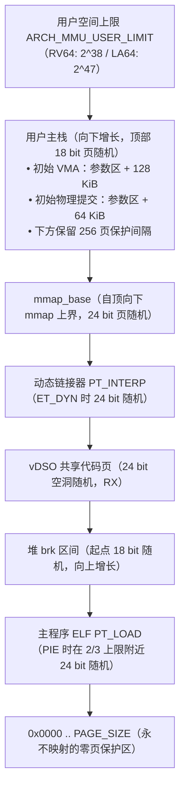

# 用户 ELF64 装载模块

用户 ELF64 装载模块负责将 64 位可执行与可链接格式（Executable and Linkable Format，ELF64）程序——包括静态可执行文件、动态链接可执行文件、位置无关可执行文件（Position-Independent Executable，PIE）以及用户态动态链接器（`PT_INTERP`）——安全地解码、规范化并构建为完整的用户虚拟地址空间与初始进程栈。RISC-V 64（4 KiB 基页 / Sv39）与 LoongArch 64（16 KiB 基页 / 三级页表）共用同一套解码器、不可变来源对象与地址布局策略；`execve` 路径解析、脚本解释与进程替换事务见 [进程映像替换模块](kernel-exec.md)。

---

## 一、源码组织

| 源码路径 | 核心职责 |
| :--- | :--- |
| `include/kernel/elf64.h`、`kernel/elf64.c` | 有界小端 ELF64 文件头与程序头解码器，执行基础结构与 `PT_LOAD` 合法性校验，支持单遍缓存读取 |
| `include/kernel/elf64_source.h`、`kernel/elf64_source.c` | 引用计数的不可变 ELF 来源对象 `struct kernel_elf64_source`：持有打开文件描述（OFD）或只读源、提取 `PT_INTERP`、将 `PT_LOAD` 规范化为无重叠页区间并提供按需缺页与邻页预取接口 |
| `include/kernel/elf_image.h`、`kernel/elf_image.c` | 跨架构映像构造器 `kernel_elf_image_build()`：完成地址空间布局随机化（ASLR）、vDSO 映射、初始栈与辅助向量（auxv）构造、VMA 登记与资源限额验收 |
| `include/arch/elf.h` | 编译期绑定目标架构机器号（`EM_RISCV = 243` / `EM_LOONGARCH = 258`）、硬件能力位（`AT_HWCAP`）、最小信号栈（`AT_MINSIGSTKSZ`）与内嵌 vDSO 镜像边界 |
| `arch/riscv/elf_image.c`、`kernel/exec.c`、`kernel/exec_image.c` | 兼容包装与 `execve` 事务编排 |

---

## 二、分层装载架构

BoarOS 将 ELF 装载清晰地划分为三层，使文件解析、按需缺页数据供应和进程地址空间布局彻底解耦：


### 2.1 有界解码器（`kernel/elf64.c`）

`kernel_elf64_open()` 与 `kernel_elf64_open_cached()` 仅通过抽象的精确读取接口 `struct kernel_read_source`（包含 `context`、总长度 `size` 与精确读回调 `read_at`）逐字节解码，绝不将整个可执行文件一次性读入内核内存：

- 校验 ELF 魔数、64 位小端格式、当前版本号、标准头尺寸（文件头 64 字节、程序头 56 字节）以及程序头数量位于 `1..128`（`KERNEL_ELF64_MAX_PROGRAM_HEADERS`）；
- 校验程序头表完整落在文件范围内；
- 逐条校验每个 `PT_LOAD` 段：`p_filesz <= p_memsz`、文件区间不越界、虚拟地址区间不溢出；若 `p_align > 1`，要求其为 2 的幂，且非空内存段（`p_memsz > 0`）必须满足文件偏移与虚拟地址对 `p_align` 同余（`p_filesz == p_memsz == 0` 的空 `PT_LOAD` 不产生映射，豁免同余检查）。
- `open_cached()` 在一次扫描中将所有程序头写入调用方提供的数组，避免后续布局与缺页阶段重复读取文件头。

### 2.2 不可变 ELF 来源与区间规范化（`kernel/elf64_source.c`）

`struct kernel_elf64_source` 是被 VMA 与 MM 共享的不可变只读对象，以原子引用计数管理寿命：

- **三种创建入口**：
  - `kernel_elf64_source_create()`：接收普通文件的打开文件描述（OFD），成功后接管其所有权，失败仍归调用者持有；
  - `kernel_elf64_source_create_interpreter()`：复用相同所有权契约，专门区分动态链接器文件短于 64 字节时的截断错误，按 Linux 惯例映射为 `IO`（`-EIO`），而完整但格式/架构错误的解释器映射为 `-ELIBBAD`；
  - `kernel_elf64_source_create_reader()`：基于调用方保证生命周期的内存只读源创建（例如内嵌只读测试 ELF），不依赖文件系统。
- **段校验与重叠拒绝**：
  - 接受 `ET_EXEC` 与 `ET_DYN` 且机器号匹配当前架构，允许至多一条绝对路径（以 `'/'` 开头、NUL 结尾、最长 4096 字节）的 `PT_INTERP`；
  - 拒绝任何两条非空 `PT_LOAD` 段的虚拟字节区间重叠；若两段落在同一架构页内（页级共享但字节不重叠），其合并权限不得同时包含写与执行（`PF_W | PF_X`）。单个自身同时声明 `PF_W | PF_X` 的装载段允许按 RWX 映射（共享文件页写入时仍先执行写时复制）。
- **页区间切分与三类供页策略（`build_runs`）**：
  构建阶段收集每个 `PT_LOAD` 段的 5 个关键页边界——段起始对齐页、首个完整页、最后一个完整文件页、文件尾所在页、段末端对齐页——按虚拟地址排序并合并为互不重叠的三类区间（`struct kernel_elf64_source_run`），供缺页时 `kernel_elf64_source_page()` 二分定位：

| 区间类型 | 构成条件 | 缺页供页方式 |
| :--- | :--- | :--- |
| **`FILE`** | 单一 `PT_LOAD` 独占整页、全页位于 `p_filesz` 内且文件偏移页对齐 | 若后备为 OFD，直接通过页缓存借用共享物理页并以 **CoW** 方式映射（多进程共享同一代码页）；支持 `kernel_elf64_source_acquire_ready()` 在同区间内批量借用最多 64 KiB 已就绪缓存邻页。若后备为只读 `reader`，则分配私有页并精确复制 |
| **`COMPOSITE`** | 文件与零填充（BSS）交界页、页内起始/末尾不对齐页，或多段同页拼合页 | 分配私有物理页，先全页清零，再遍历贡献该页的每个 `PT_LOAD` 段精确读入 `p_filesz` 范围内的文件字节，保持尾部 BSS 为零 |
| **`ZERO`** | 完全超出 `p_filesz` 的纯零填充（BSS）页 | 按需分配并全页清零的私有物理页 |

---

## 三、用户地址空间布局、ASLR 与初始栈

`kernel_elf_image_build()` 在建立新地址空间时，以按需装页为核心原则：**构建阶段只向物理内存预提交覆盖初始参数的栈页与 vDSO 页**，主程序与动态链接器的所有 `PT_LOAD` 区间仅登记为 `ELF_PRIVATE` / `KERNEL_VMA_FAULT_ELF` VMA，直到用户态真正跳入入口点取指或访问数据时再由缺页处理按需装入。

### 3.1 静态/动态/PIE 形态与合法性检查

- 支持静态与动态 `ET_EXEC`、带 `PT_INTERP` 的 PIE `ET_DYN` 以及独立无解释器的 `ET_DYN`；动态链接器本身不得递归声明 `PT_INTERP`。
- 重定位（`PT_DYNAMIC`、`RELRO`）与线程局部存储（`PT_TLS`）的元信息完整保留在源程序头中，由用户态动态链接器（如 musl / glibc `ld.so`）依据辅助向量自行完成，内核无需在内核态解析动态符号。
- 入口地址必须满足 2 字节指令对齐（兼容 RISC-V 压缩指令 `IALIGN = 16`）且落入某条可执行 `PT_LOAD` 段的文件字节内（不能落在 BSS 或空洞中）。
- `AT_PHDR` 仅当完整程序头表落于某个 `PT_LOAD` 段的文件与内存范围内时填入其用户虚拟地址；PIE 或带解释器的动态映像缺少有效 `AT_PHDR` 视为格式错误。

### 3.2 虚拟地址布局与地址空间布局随机化（ASLR）

除非进程设置了 `ADDR_NO_RANDOMIZE` 个性位（`KERNEL_PERSONALITY_ADDR_NO_RANDOMIZE`）或随机子系统尚未获得任何种子材料，内核调用 `kernel/random.c` 的 ChaCha20 状态为以下 6 个区域独立生成随机偏移（并严格校验对齐、用户上限与互不冲突）：



- **随机数与熵边界**：设备树 `/chosen/rng-seed` 提供不少于 32 字节材料时，`kernel/random.c` 将其混入 ChaCha20 状态以启用布局随机化，但不记作密码学可信熵（只有 VirtIO RNG 累计输入满 32 字节后 `kernel_random_ready()` 才就绪）。每次 `exec` 均以非阻塞方式生成 16 字节 `AT_RANDOM` 供 `libc` 在进入 `main` 前初始化栈金丝雀（Stack Canary），不阻塞也不改变 `getrandom` 系统调用的等待语义。
- **栈权限与限额**：
  - 栈默认不可执行（`RW`）；若主 ELF 中最后一个 `PT_GNU_STACK` 带有 `PF_X`，则赋予整个栈 VMA 与初始栈页执行权限（解释器的 `PT_GNU_STACK` 不覆盖主程序设置）。
  - 初始栈 VMA 覆盖参数序列化区并向下预留 **128 KiB**（`KERNEL_ELF_STACK_EXPAND`），初次仅物理映射覆盖参数与最多 **64 KiB** 余量（`KERNEL_ELF_STACK_HEADROOM`）的页面，受 `RLIMIT_STACK`（默认软限 8 MiB）约束；完整初始栈放不进软栈限额或参数/环境变量超出预算时返回 `E2BIG` 并保留原进程映像。
  - 在最终提交前，按 `exec` 捕获的 `RLIMIT_AS` 与 `RLIMIT_DATA` 快照整体验收全部 VMA 用量，超限返回 `ENOMEM` 并回收候选地址空间；主 ELF 的代码与数据文件边界（`start_code`/`end_code`/`start_data`/`end_data`）另行记录供 `/proc/<pid>/stat` 与后续 `brk` 字节级限额检查使用。

### 3.3 初始栈帧与辅助向量（`auxv`）

初始栈指针 `sp` 按过程调用标准（psABI）向下 16 字节对齐，从低地址向高地址依次排布：

```text
sp ──▶ [ argc ]
       [ argv[0], ..., argv[argc-1], NULL ]
       [ envp[0], ..., envp[envc-1], NULL ]
       [ auxv (type, value) 键值对 ..., (AT_NULL, 0) ]
       [ argv 字符串..., envp 字符串..., 可执行路径字符串, 16 字节 AT_RANDOM ] ──▶ stack_top
```

内核向用户态发布的完整辅助向量条目包括：

| 辅助向量键（编号） | 写入值说明 |
| :--- | :--- |
| `AT_PAGESZ` (6) | 架构基页大小（RV64 为 4096，LA64 为 16384） |
| `AT_PHDR` (3) / `AT_PHENT` (4) / `AT_PHNUM` (5) | 主程序头表用户虚拟地址、单条长度（56 字节）与条目数 |
| `AT_BASE` (7) / `AT_FLAGS` (8) / `AT_ENTRY` (9) | 动态链接器装载偏移（无解释器为 0）、标志（0）与主程序入口地址 |
| `AT_HWCAP` (16) | 硬件能力位图：RISC-V 为 `IMAFDC`（存在向量扩展 `riscv_vector_vlenb > 0` 时附加 `V` 位）；LoongArch 由 `la_user_hwcap()` 提供 |
| `AT_MINSIGSTKSZ` (51) | RISC-V 架构额外发布：最小信号栈字节数（启用向量扩展时按 `1152 + 32 * vlenb` 计算，否则为 `1088`） |
| `AT_CLKTCK` (17) | 时钟滴答频率（`100`） |
| `AT_UID` (11) / `AT_EUID` (12) / `AT_GID` (13) / `AT_EGID` (14) / `AT_SECURE` (23) | 本次执行凭据转换后的真实/有效用户与组 ID 及安全执行模式标志 |
| `AT_RANDOM` (25) / `AT_EXECFN` (31) | 栈上 16 字节随机数据地址与可执行路径字符串地址 |
| `AT_SYSINFO_EHDR` (33) | 启用内嵌 vDSO ELF 时指向用户空间 vDSO 基址 |
| `AT_NULL` (0) | 向量终止符 |

---

<details>
<summary>展开查看：所有权清理分层与双架构验证入口</summary>

### 分层所有权与失败回滚

- `exec` 事务在构建期间临时持有主程序与解释器的 `kernel_elf64_source` 引用；映像构建成功后，MM 通过 VMA 与来源登记表持有独立引用，随后事务释放临时引用。
- 构建任一步骤失败（格式错误、架构不匹配、地址冲突、栈超限或内存耗尽）均先完整保留调用进程原有 MM；候选空间通过 `cleanup_space()` 逐层释放 MM 与底层页表。
- `kernel_elf64_source` 的最后一次 `release` 按“打开文件描述 → 解释器路径 → 临时边界 → runs 与程序头数组 → 自身对象”的顺序回收；只有关闭 OFD 时发生的真实 VFS/I/O 清理错误会返回 `CLEANUP_REQUIRED` 保留所有权供外层重试，绝不静默丢弃打开的文件句柄。

### 双架构运行库支持与定向验证入口

- **边界与段特性验证**：`make test-elf-boundary-riscv test-elf-boundary-loongarch TEST_MEMORIES="512M 1G"`、`make test-elf-rwx-riscv`、`make test-elf-tail-riscv`
- **按需装页、执行事务与根启动**：`make test-demand-page-riscv`、`make test-exec-riscv`、`make test-root-init-riscv`、`make test-riscv`
- **双架构 GNU/musl 运行库验收**：`make test-glibc-riscv`、`make test-glibc-loongarch`、`make prepare-la-glibc test-glibc-profile-host`、`python3 -B tests/userland/glibc/run.py --arch riscv|loongarch`（覆盖静态、动态、PIE、静态 PIE 与 pthread PIE 五种形态，含 TLS、dlopen TLS 与信号处理；LoongArch 平台细节见 [LoongArch 启动模块](loongarch-boot.md)）

</details>
