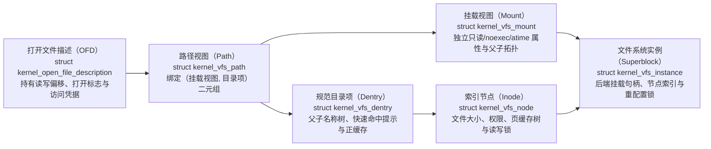
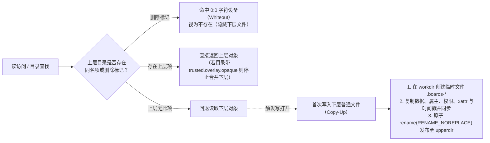

# 虚拟文件系统（VFS）、ext4 与叠加文件系统

BoarOS 的虚拟文件系统（Virtual File System，VFS）屏蔽了不同存储后端的格式差异，向上为所有系统调用提供统一的路径解析、权限检查、挂载视图与页缓存服务，向下接入 **ext4 / ext2（含 JBD2 事务日志）、可写叠加文件系统（OverlayFS）、FAT32/VFAT、tmpfs、procfs、sysfs、devpts、tracefs、bpffs 与 cgroup2** 等多类文件系统。

---

## 一、源码组织

| 源码路径 | 核心职责 |
| :--- | :--- |
| `include/kernel/vfs.h`、`fs/vfs_objects.h` | 通用 VFS 实例、挂载视图、索引节点、目录项、路径对象与后端操作表 |
| `fs/vfs.c` | 路径解析与热路径缓存、挂载树与传播关系、权限检查、直接 I/O 协调、文件句柄编解码 |
| `fs/fs_context.c`、`fs/mount_context.c` | 进程挂载命名空间、`pivot_root` 与现代挂载配置接口（`fsopen`/`fsconfig`/`fsmount`） |
| `fs/page_cache.c`、`fs/file_mapping.c` | 统一页缓存（读/写/`mmap` 共享）、反向写保护、预读/写回窗口与映射代次同步 |
| `fs/ext4_backend.c`、`fs/lwext4_port.c` | ext4 适配层、JBD2 多核日志调度、延迟分配、多核目录级并行锁、ACL 与扩展属性 |
| `third_party/lwext4/` | 磁盘格式解析、区段树（Extent Tree）、块组索引节点表位置缓存与分组日志实现 |
| `fs/overlay.c` | 可写叠加文件系统（下层/上层/工作目录合并、写时复制提升、删除标记与不透明目录） |

---

## 二、VFS 五层对象模型与挂载命名空间

### 2.1 核心对象分离

BoarOS 严格分离文件系统中职责不同的五类核心对象，确保重命名、硬链接、绑定挂载（Bind Mount）与多描述符共享行为与 Linux 语义一致：

- **路径与文件解耦**：同一文件系统实例可通过绑定挂载暴露出多个独立的 `kernel_vfs_mount` 视图（各自拥有独立的 `read_only`、`noexec`、`nodev`、`nosuid` 与 `atime` 策略）；同一 `inode` 可对应多个硬链接 `dentry`；文件被改名或删除后，已打开的 `OFD` 仍通过持有 `dentry` 和 `inode` 引用继续访问原文件本体。
- **挂载命名空间与现代挂载 API**：进程可通过 `clone`/`unshare(CLONE_NEWNS)` 复制整棵挂载视图树（失败时按叶到根迭代回滚，不消耗递归栈），通过 `setns` 加入目标挂载命名空间；同时支持 Linux 新一代基于文件描述符的挂载接口：`fsopen(430)`、`fsconfig(431)`、`fsmount(432)`、`fspick(433)`、`open_tree(428)`、`move_mount(429)`、`mount_setattr(442)` 以及 `pivot_root(41)`。旧 `mount(40)` 与新接口共用 `fs/mount_context.c` 的同一套实例创建与重配置实现。

### 2.2 高效路径解析与三级缓存

路径查找（`resolve_object`）通过复用路径对象和文件系统元数据减少查盘与动态内存分配：

1. **零拷贝分量切片与栈上双槽遍历**：直接基于调用者路径字符串的指针与长度逐段比对名称，只在新建目录项时复制字符串，仅在展开符号链接（上限 `VFS_SYMLINK_MAX_FOLLOWS = 40` 层）时分配临时展开区。遍历中间目录时在栈上的两个临时槽位 `components[2]` 之间交替推进，未遇挂载点时不分配堆包装、不写入挂载路径索引。
2. **父目录最近命中提示（`lookup_hint`）**：每个目录项在自有子名称锁（`names_lock`，Rank 31）下维护有序子项 AVL 树，并记住最近一次命中的子项 `lookup_hint`，重复访问公共路径前缀可 O(1) 命中。
3. **有界正目录项缓存**：为活跃目录、普通文件和符号链接维护二次机会 LRU 正缓存，上限随系统物理页总数按 `pages / 256` 自动计算并钳位在 **`16 ～ 8,192`** 项，并在内存压力下自动裁剪。
4. **ext4 短名缺失负缓存**：`struct lwext4_directory_mapping` 在活跃目录的既有映像内附带 2 个最长 **40 字节**的缺失名称槽位（经 16 位哈希摘要筛除偶发缺失，反复缺失才登记），在目录 `metadata_epoch` 未变时重复查找不存在的文件直接返回 `ENOENT`，无需再次读盘扫描目录块。
5. **ext4 短符号链接**。打开索引节点时，后端从已读取的索引节点快照保存内联链接目标。路径解析和 `readlinkat` 持有对应索引节点时直接使用这份不可变内容。重命名或删除目录项后，已有引用仍能读取原目标，新建同名链接使用新索引节点。外置数据块中的目标沿普通后端读路径取得。

---

## 三、统一页缓存与内存映射一致性

所有磁盘普通文件的 `read`/`write` 读写与 `mmap` 共享映射均经由 `fs/page_cache.c` 的统一页缓存访问，每个缓存项 `struct kernel_page_cache_entry`（紧凑控制在 256 字节内）挂入所属 `inode` 的全量页红黑树（`page_link`）与脏页红黑树（`dirty_link`）。

### 3.1 预读、写回批次与干净页回收

- **顺序预读窗口（RA16）**：4 KiB 页默认预读窗口为 **64 KiB（16 页）**（`BOAROS_PAGE_CACHE_READAHEAD_PAGES`）；检测到连续顺序读取（或设置 `POSIX_FADV_SEQUENTIAL`）时自适应倍增至最多 2 倍窗口。
- **批量写回窗口（WB32）**：单次写回批次上限为 **128 KiB（32 页）**（`BOAROS_PAGE_CACHE_WRITEBACK_PAGES`），后台脏页占比超过 **75%** 时触发后台写回。
- **干净页回收**：物理内存紧张时，`reclaim_clean_pages()` 从全局 LRU 尾部按 64 项窗口扫描，仅回收无脏数据、无加载/写回在途、无映射别名且引用计数为 1 的干净缓存页（多核采用二次机会 `accessed` 标记），同时联动裁剪目录项缓存与 `lwext4` 块缓存。
- **热映射缓存访问**。文件缺页在索引节点的缓存树中按偏移找出窗口内已就绪的页，并分批取得物理页引用。单核构建的窗口多于四页时，若相邻命中的缓存项在最近最少使用（Least Recently Used，LRU）链表中按相反方向相邻，将整段一次移动到表头。排序结果和回收游标与逐页更新一致。

### 3.2 共享映射写回的一致性保护

当一个文件页同时被 `mmap(MAP_SHARED)` 映射到用户空间且正准备写回磁盘时，如果用户线程在磁盘 DMA 期间改写该页，可能造成落盘数据损坏或新修改被误清脏。`fs/page_cache.c` 与 `fs/file_mapping.c` 协同解决了这一竞态：
1. 写回准备阶段设置 `CACHE_WRITES_CLOSED`，并遍历缓存页的反向映射别名链表 `entry->aliases`，在缓存锁外调用 `rearm_aliases()` 将所有关联的用户态页表项暂时降级为**只读**，排空正在进行的内核写入借用；
2. 随后将当前脏数据快照复制到版本缓冲区（来自 `version_pool`，容量动态保持在 64～1,024 页）并放开 `CACHE_WRITES_CLOSED`；
3. 若写回期间用户态再次写入该共享映射页，会触发写缺页中断，递增 `entry->generation` 并重新标脏；旧写回完成后比对代次发现数据已更新，绝不会错误清除新脏状态。

对于文件截断（`ftruncate`）、打洞（`fallocate`）与直接 I/O（`O_DIRECT`），`fs/file_mapping.c` 通过关闭映射代次（`FILE_MAPPING_CLOSED`）暂时阻塞新缺页、撤销受影响页表项并排空在途借用，修改完成后再重新开放代次。

---

## 四、ext4 后端：日志、延迟分配、直接 I/O 与多核并行

BoarOS 以 `third_party/lwext4` 作为磁盘格式解析基础，在 `fs/ext4_backend.c`、`fs/lwext4_port.c` 与本地日志/并发扩展中构建了完整的生产级 ext4 后端（同时支持可写无日志 ext2/ext4）：

### 4.1 分组 JBD2 事务日志与持久化目标

- **分组提交与多核选核**：启用日志的 ext4 使用分组事务模型（`jbd_journal_accept` / `freeze` / `submit` / `checkpoint`），日志内存预算上限为 `min(物理总内存 / 32, 16 MiB)`。多核启动时，日志提交线程（`journal_worker`）与检查点回填线程（`journal_checkpoint_worker`）按挂载与在线核数分散到各副核运行，不全部挤在 CPU0。
- **精确的 `fsync` 等待**：显式同步请求把本次需要落盘的日志序列号封装为 `kernel_vfs_sync_request` 挂入 `adapter->sync_waiters` 平衡树，等待目标事务提交并完成块设备 `FLUSH` 缓存刷新屏障后被唤醒。

### 4.2 延迟分配（Delalloc）与元数据空间预留

向启用日志的 ext4 文件空洞写入数据时，`ext4_file_reserve_write()` 不会在 `write` 系统调用期间立刻修改磁盘区段树，而是按 64 块为单位在红黑树 `ext4_delalloc_tree` 中登记延迟分配预留，等到脏页真正写回时再一次性分配大段连续物理块以显著减少磁盘碎片。

为防止“前台写入成功但写回时因区段树分裂无空闲块导致 `fsync` 失败”，预留阶段同时按最坏深度扣减**数据块额度**（`delayed_blocks`）与**区段树元数据块额度**（`delayed_extent_blocks = charged × EXT4_EXTENT_MAX_DEPTH`）；当剩余可用块极度紧张时自动回退到直接区段分配，确保空间耗尽时在前台及时返回 `ENOSPC`。

### 4.3 多核目录级并行锁与块组位置缓存

- **多核目录并行（`namespace_parallel`）**：当系统实际启动超过 1 颗核且挂载为可写分组日志 ext4 时，内核自动启用目录级并行模式。VFS 层对查找与目录枚举仅取目标目录的共享读锁，对创建与删除取父目录独占写锁，对跨目录 `rename` 按 `inode` 编号升序锁定涉及目录；后端 `fs/lwext4_port.c` 则按统一资源等级（`EXT4_RESOURCE_INODE = 31`、`ORPHAN = 32`、`BLOCK_GROUP = 35`）动态管理细粒度锁，检测到逆序或升级冲突时通过 `EAGAIN` 安全回滚重试，避免死锁。
- **块组索引节点表位置缓存**：挂载后，`ext4_fs.c` 在 `fs->inode_table_starts` 中按块组无锁原子缓存经校验和验证的 `inode` 表起始块号，后续装入冷 `inode` 无需重复读取块组描述符；仅当可能改写布局的通用写操作触发时原子失效对应块组条目。

### 4.4 高级文件语义：直接 I/O、稀疏文件、ACL 与文件句柄

- **有序直接 I/O（`O_DIRECT`）**：绕过页缓存直接按块设备逻辑扇区对齐（可通过 `statx(STATX_DIOALIGN)` 查询）执行读写。执行前先写回并失效相交的旧页缓存和共享映射，确保缓存视图与直写内容一致；日志卷下保留有序数据版本并在日志提交前按序落盘。
- **空间操作与稀疏定位**：`fallocate` 支持普通预分配、保持文件长度（`FALLOC_FL_KEEP_SIZE`）、打洞释放块（`FALLOC_FL_PUNCH_HOLE`）以及清零区段（`FALLOC_FL_ZERO_RANGE`，将完整数据块高效转为未写入区段）；`lseek` 支持 `SEEK_DATA` / `SEEK_HOLE` 同时合并磁盘区段映射与页缓存中的未落盘脏页。
- **POSIX 访问控制列表（ACL）与扩展属性（xattr）**：支持 `system.posix_acl_access` / `system.posix_acl_default` 与通用扩展属性；活跃目录缓存“无默认 ACL”结论，加速同目录连续创建文件。
- **文件句柄编解码（`name_to_handle_at` / `open_by_handle_at`）**：ext4 句柄编码卷 UUID、32 位 `inode` 号与磁盘代次（`generation`），支持跨重命名重打开以及节点回收复用后的旧句柄失效检测（返回 `ESTALE`）；冷目录句柄通过沿 `".."` 向上重建目录项链恢复路径。

---

## 五、可写叠加文件系统（OverlayFS）

`fs/overlay.c` 实现了将只读或共享的 ext4 **下层目录（`lowerdir`）** 与可写的 ext4 **上层目录（`upperdir`）** 合并为单一挂载视图的叠加文件系统（常见于容器根文件系统分层）。可写挂载需额外提供位于上层同一挂载下的空 **工作目录（`workdir`）**。

- **原子写时复制提升（Copy-Up）**：修改位于下层的普通文件（当前支持单硬链接普通文件与目录）时，先在 `workdir` 中完整复制正文、权限、属主与扩展属性并落盘，再通过不覆盖重命名原子移入 `upperdir`，保证中途失败或断电不会在上层留下残缺文件。
- **删除标记与不透明目录**：删除下层已有文件时在上层创建设备号 `0:0` 的字符设备作为删除标记（Whiteout）；在删除标记位置重建同名目录时，通过同一 ext4 日志事务原子交换目录并写入 `trusted.overlay.opaque = "y"` 扩展属性，阻断同名下层目录合并。
- **跨实例 `copy_file_range` 与访问通知**。两个 OverlayFS 实例可以通过各自选定的后备文件复制数据。内核从已打开的源文件选定当前后备层，目标文件使用可写上层。实际数据复制要求两个后备文件属于同一文件系统实例，绑定挂载提供的新访问路径仍属于原实例。普通 ext4 文件描述符与 OverlayFS 文件描述符混用时返回 `EXDEV`。完整的组合、重叠范围和文件位置规则见 [文件范围复制](kernel-files.md#33-copy_file_range-的文件组合与完成边界)。通过叠加视图发生的访问可以同时向后备对象和合并视图的 `fanotify` 监视组交付事件。

---

展开查看：挂载重配置契约、权限规则与定向验证入口

### 关键边界与挂载重配置契约

| 机制 | 规则说明 |
| :--- | :--- |
| **`MS_REMOUNT` 与只读切换** | 独占文件系统 `reconfiguration` 写锁（Rank 19）；存在可写 OFD（`write_openers > 0`）或未清理孤儿节点时拒绝转只读（返回 `EBUSY`）；ext4 转只读前排空全部脏页与检查点并暂停日志线程，转读写时重新登记写回域并启动新日志会话。 |
| **`MNT_EXPIRE` 两步过期卸载** | 首次调用标记空闲视图过期并返回 `EAGAIN`，期间任何普通路径访问清除标记；再次调用若仍保持过期标记且无忙引用则同步卸载。 |
| **凭据与访问权限** | 普通操作使用 `fsuid`/`fsgid` 与补充组，`access` 使用真实 UID/GID；`CAP_DAC_OVERRIDE` 越过读写及目录搜索位，`CAP_DAC_READ_SEARCH` 越过读与搜索位；`SGID` 目录自动继承组与子目录 `SGID` 位；`sticky` 目录删除校验实际属主。 |
| **OverlayFS 当前边界** | 支持单下层 + 可选上层/工作目录的可写 ext4 叠加；多下层配置、下层多硬链接文件写时复制以及涉及移动下层目录的重命名留待扩展（返回 `EOPNOTSUPP`）。 |

### 定向验证入口

- **多核目录并行与映射并发（宿主）**。`make test-ext4-backend-parallel-host` 运行后端和目录并发检查，覆盖通用目录测试和 ext4 专项。`make test-file-mapping-concurrency-host` 检查文件映射、失效与在途借用的交错。
- **直接 I/O 与日志断电恢复（宿主与客机）**：`JOURNAL_TEST_CASE=direct-ordered sh tests/host/lwext4-journal.sh`、`sh tests/host/lwext4-metadata.sh direct-reuse`、`tests/userland/direct-file.py`。
- **POSIX ACL、文件句柄与挂载命名空间**：`tests/userland/acl-lib-consumer.py`、`tests/workloads/io/file-handles.c`、`tests/workloads/resource/mount_namespace.c`。

