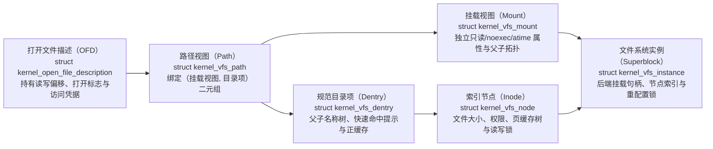
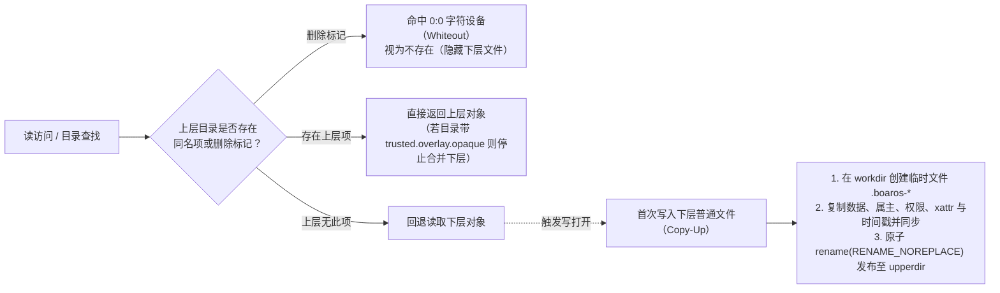

# 虚拟文件系统（VFS）、ext4 与叠加文件系统

BoarOS 的虚拟文件系统（Virtual File System，VFS）屏蔽了不同存储后端的格式差异，向上为所有系统调用提供统一的路径解析、权限检查、挂载视图与页缓存服务，向下接入 **ext4、ext3、ext2、可写叠加文件系统（OverlayFS）、FAT32/VFAT、tmpfs、procfs、sysfs、devpts、tracefs、bpffs 与 cgroup2** 等多类文件系统。

---

## 一、源码组织

| 源码路径 | 核心职责 |
| :--- | :--- |
| `include/kernel/vfs.h`、`fs/vfs_objects.h` | 通用 VFS 实例、挂载视图、索引节点、目录项、路径对象与后端操作表 |
| `fs/vfs.c` | 路径解析与热路径缓存、挂载树与传播关系、权限检查、直接 I/O 协调、文件句柄编解码 |
| `fs/fs_context.c`、`fs/mount_context.c` | 进程挂载命名空间、`pivot_root` 与现代挂载配置接口（`fsopen`/`fsconfig`/`fsmount`） |
| `fs/page_cache.c`、`fs/file_mapping.c` | 统一页缓存（读/写/`mmap` 共享）、反向写保护、预读/写回窗口与映射代次同步 |
| `fs/ext4_backend.c`、`fs/lwext4_port.c` | ext4 适配层、JBD2 多核日志调度、延迟分配、多核目录级并行锁、ACL 与扩展属性 |
| `third_party/lwext4/` | 磁盘格式解析、区段树（Extent Tree）、块组索引节点表位置缓存与分组日志实现 |
| `fs/overlay.c` | 可写叠加文件系统（下层/上层/工作目录合并、写时复制提升、删除标记与不透明目录） |
| `kernel/block.c`、`drivers/nvme/pci.c` | 块设备注册、分区与传输保护，以及原生 NVMe 数据传输和命令完成 |

### 原生 NVMe 块设备

RISC-V 和 LoongArch 的 QEMU 虚拟机可在 VirtIO 根盘之外挂接非易失性存储器高速接口（Non-Volatile Memory Express，NVMe）控制器。驱动通过外围组件互连高速总线（Peripheral Component Interconnect Express，PCIe）发现控制器及其命名空间，按实际逻辑块大小注册为 `/dev/nvme0n1` 等设备。普通文件的读写、文件系统写回和持久化请求继续通过共同的块层。

驱动分别维护管理和数据提交队列。块层批量传入请求时，驱动先准备各请求的直接内存访问（Direct Memory Access，DMA）缓冲区，再批量写入描述符，共用一次设备通知。完成队列返回实际命令状态后才能重用缓冲区。超时触发设备停用，已发布的缓冲区保留到硬件确认安全。控制器重置失败时，驱动继续持有可能仍被设备访问的内存。

`/dev/nvme0` 和 `/dev/ng0n1` 分别提供控制器和命名空间命令。通过 `io_uring` 的 128 字节提交项和 32 字节完成项，可以执行控制器识别、读取日志、查询特性，以及命名空间读、写、比较和刷新。接口接受连续缓冲区和向量，用户复制在设备队列保护之外完成，访问权限在命令发布前核对。

---

## 二、VFS 五层对象模型与挂载命名空间

### 2.1 核心对象分离

BoarOS 严格分离文件系统中职责不同的五类核心对象，确保重命名、硬链接、绑定挂载（Bind Mount）与多描述符共享行为与 Linux 语义一致：

- **路径与文件解耦**：同一文件系统实例可通过绑定挂载暴露出多个独立的 `kernel_vfs_mount` 视图（各自拥有独立的 `read_only`、`noexec`、`nodev`、`nosuid` 与 `atime` 策略）；同一 `inode` 可对应多个硬链接 `dentry`；文件被改名或删除后，已打开的 `OFD` 仍通过持有 `dentry` 和 `inode` 引用继续访问原文件本体。
- **挂载命名空间与现代挂载 API**：进程可通过 `clone`/`unshare(CLONE_NEWNS)` 复制整棵挂载视图树（失败时按叶到根迭代回滚，不消耗递归栈），通过 `setns` 加入目标挂载命名空间；同时支持 Linux 新一代基于文件描述符的挂载接口：`fsopen(430)`、`fsconfig(431)`、`fsmount(432)`、`fspick(433)`、`open_tree(428)`、`move_mount(429)`、`mount_setattr(442)` 以及 `pivot_root(41)`。旧 `mount(40)` 与新接口共用 `fs/mount_context.c` 的同一套实例创建与重配置实现。

- **结构化挂载查询**：`statmount(457)` 查询挂载及文件系统属性，`listmount(458)` 按唯一挂载编号分页列举可见的挂载子树。两者接受当前命名空间或挂载命名空间文件描述符。`statmount` 还可以通过带路径的文件描述符查询实际挂载，延迟卸载后的旧描述符仍能取得原挂载属性，响应省略挂载点和命名空间编号。挂载树只在树根记录命名空间归属，查询沿父连接定位归属，树根退休时撤下关联。
- `statmount`、`listmount`、`statx(STATX_MNT_ID_UNIQUE)` 和 `name_to_handle_at(AT_HANDLE_MNT_ID_UNIQUE)` 共用唯一挂载编号。`/proc/<pid>/mountinfo` 继续输出传统编号。查询在挂载拓扑锁内捕获连接、路径和传播属性，在锁外完成排序、文件系统查询和用户复制。支持掩码列出实际返回的字段。其他命名空间的数字编号查询返回 `EOPNOTSUPP`，持有其文件描述符即可查询。

### 2.2 高效路径解析与三级缓存

路径查找（`resolve_object`）通过复用路径对象和文件系统元数据减少查盘与动态内存分配：

1. **零拷贝分量切片与栈上双槽遍历**。路径解析器按指针与长度逐段比对名称，新建目录项时才复制名称，展开符号链接时才分配临时展开区（上限 `VFS_SYMLINK_MAX_FOLLOWS = 40` 层）。遍历中间目录时，在栈上的两个临时槽位 `components[2]` 之间交替推进。临时槽位用引用计数零表示空闲，绑定时写入解析所需的文件视图、目录项和所有权字段。挂载路径索引和链表由持久路径对象维护。
2. **父目录子项索引**。每个目录项的平衡二叉搜索树（Adelson-Velsky and Landis Tree，AVL 树）保存已发布的直接子项。写者同时持有全局路径状态锁和父目录名字锁。读者持有其中任一锁即可查找子项，短路径命中最近提示 `lookup_hint` 时只比较一个名字。首次查找未命中时记录父目录的子项发布代次。后端返回后，代次未变即可确认同名目录项仍未发布，期间有并发发布则重新查找。
3. **有界正目录项缓存**：为活跃目录、普通文件和符号链接维护二次机会 LRU 正缓存。每个实例按系统每 1 MiB 物理内存对应一个目录项计算上限，范围为 16～8,192 项。两种架构的相同物理内存容量对应相同的条目预算。内存压力下可以提前回收缓存条目。
4. **ext4 短名缺失负缓存**：`struct lwext4_directory_mapping` 在活跃目录的既有映像内附带 2 个最长 **40 字节**的缺失名称槽位（经 16 位哈希摘要筛除偶发缺失，反复缺失才登记），在目录 `metadata_epoch` 未变时重复查找不存在的文件直接返回 `ENOENT`，无需再次读盘扫描目录块。
5. **ext4 短符号链接**。打开索引节点时，后端从已读取的索引节点快照保存内联链接目标。路径解析和 `readlinkat` 持有对应索引节点时直接使用这份不可变内容。重命名或删除目录项后，已有引用仍能读取原目标，新建同名链接使用新索引节点。外置数据块中的目标沿普通后端读路径取得。
6. **ext4 普通文件属性查询**。路径查询通过各级目录的搜索权限检查后，如果末段是尚未建立目录项的普通文件，`stat` 和 `statx` 可以直接返回索引节点属性。虚拟文件系统在同一保护区间查找目录项和活动索引节点，并记录实例的节点发布代次。已有活动节点时借用该节点，读取延迟分配、文件长度和时间戳。复制已校验的表记录后，如果代次未变，可复用之前的查找结果。慢速读取或发布代次变化时，再查活动节点以覆盖通过其他硬链接打开的情形。符号链接、挂载点和需要查询直接输入／输出（Direct Input/Output，Direct I/O）对齐的请求继续解析完整路径。
7. **ext4 名称索引**。当路径未命中虚拟文件系统的完整目录项时，后端先在当前文件系统实例的索引中查找父目录编号和完整名称。小于或等于 43 字节的名称每条占用 64 字节。索引使用四路组相联的散列表，按需申请 16 KiB 内存，载荷预算为物理内存的 `1/256`、每实例最多 2 MiB。散列值按实际分块数映射，分块数可取预算内任意整数。目录修改通知在写入目录记录前推进对应分区的代次，持有目录写资格直到事务结束。索引条目保存名称及目标编号，内存压力时可以归还整个索引载荷。路径仍检查目录搜索权限、挂载点和活动索引节点。
8. **合并已缓存的路径前缀**。持有实例级命名空间资格的属性查询，在一次状态锁保护内查找最多四级普通目录。每级按照实际调用者凭据验证搜索权限，离开状态锁时只持有最后一个命中目录的引用。如果下一段就是普通末级名称，解析器用已识别的文件名范围和该目录项直接查找目标，结果确定后归还目录引用。遇到需要继续遍历的分量或需要跟随的相对符号链接时，再建立临时路径对象。使用逐目录命名空间资格的实例继续逐级交接所有权。
   状态锁内保留最近一次解析得到的多级目录前缀，键为挂载视图、起始目录和最多 64 字节的完整前缀。下次匹配时沿已有父指针检查搜索权限和当前根及挂载边界，省去逐级查询名称索引。缓存只保存弱引用；任一级目录因改名、删除或最后关闭而退出名称索引时，索引修改与缓存失效在同一把状态锁内完成。命中后取得末级目录的引用才释放状态锁。

路径系统调用在一次任务状态检查中借用当前线程的文件描述符表、文件系统上下文和地址空间。打开文件时取得创建描述符所需的额度，属性查询直接复用用户路径导入时记录的长度。RISC-V 每次推进四个字节，遇到字符串终止字节便结束。跨页缺页处理从发生故障的字节恢复，已复制的前缀留在内核缓冲区。

属性查询可以用已验证的索引节点表位置，从空闲、干净的缓存块中直接复制目标记录。挂载时从已经校验的文件系统几何信息计算索引节点表块内的记录位宽，查询时用移位和掩码选取表块和块内记录。已校验的记录直接复制属性所需字段。尚未校验且长度至多 256 字节的记录复制到调用栈，在缓存保护外校验。校验结果只登记到版本仍匹配的表块，块被驱逐、替换或开放原地写入后，迟到的校验结果不能更新当前块的验证位图。复制后再次核对索引节点表位置。需要读盘、存在事务私有视图、块已有借用或校验失败时，继续执行原有的块借用和校验过程。活动索引节点仍提供当前文件长度和延迟分配状态。末级查询在搜索活动索引节点失败时保留相邻键之间的空区间。同一实例内的后续查询命中该区间时可以跳过索引遍历。新节点落入区间时，发布者在同一虚拟文件系统状态锁内清除区间。

解码属性时，ext4 按索引节点大小和扩展区长度一次确定访问、修改和状态变更三个时间戳的扩展字段是否存在。新建活动节点时复用同一份解码结果初始化内存时间戳。超级块和索引节点的类型保留磁盘格式规定的紧凑字段偏移，并声明内存对象的四字节对齐。索引节点表记录由已校验的记录步长和对齐的块缓冲区保证对齐，日志回放中的超级块由块内固定偏移保证对齐。RISC-V 由此可以直接加载对齐的字段。组装 `stat` 和 `statx` 的用户结构时直接写入属性字段，并将保留字段及尚未提供的字段置零，再把完整结构复制给调用者。

扩展属性读取以只读方式借用索引节点表，保留当前块版本上已完成的校验。对已确认没有访问控制列表（Access Control List，ACL）的活动索引节点，权限检查以原子读取核对元数据代次和缺失标记。调用者的目录或索引节点锁与权限修改互斥。在普通权限位判断中，如果组成员和其他用户对本次请求拥有相同权限，可以省去补充组查询。索引节点的元数据代次变化后重新查询访问控制列表，事务的私有视图始终读取自己的属性。

线性目录从上一次成功查找的逻辑块开始，扫描到目录末尾后回到开头，直到找到完整匹配或查完全部块。该提示保存在活动目录映像中，文件名仍按磁盘记录验证。对齐的记录头用一个 32 位加载取得记录长度和名称长度。对不超过 4 KiB 的对齐目录块，第一次完整验证记录边界后，将验证结果和名称长度格式登记到该块的缓存载荷。后续搜索同一份数据时可以直接按已验证的边界推进，仍检查记录是否在用并比较完整名称。载荷开放原地写入时禁止复用，发布新版本时重新验证。如果已经找到目标，后续坏记录不会改变本次命中，但整块不会取得可复用的验证结果。具有散列树（Hash Tree，HTree）索引的目录仍用自身索引选择要搜索的块。

每个 ext4 实例将物理内存的 `1/64` 作为后端块缓存的空闲载荷目标，下限为 128 KiB，上限为 8 MiB。目录块和索引节点表按实际读取分配，内存紧张时可以回收无借用的干净块。最近命中的 16 个块索引槽与红黑树共用保护，在块退役时同时撤下。槽位命中时直接取得当前块版本，落空时查红黑树。已经验证过的索引节点和块组描述符直接复用校验结果，只在首次通过校验时发布对应的位图标记。

---

## 三、统一页缓存与内存映射一致性

所有磁盘普通文件的 `read`/`write` 读写与 `mmap` 共享映射均经由 `fs/page_cache.c` 的统一页缓存访问，每个缓存项 `struct kernel_page_cache_entry`（紧凑控制在 256 字节内）挂入所属 `inode` 的全量页红黑树（`page_link`）与脏页红黑树（`dirty_link`）。

### 3.1 预读、写回批次与干净页回收

- **顺序预读窗口（RA16）**：4 KiB 页默认预读窗口为 **64 KiB（16 页）**（`BOAROS_PAGE_CACHE_READAHEAD_PAGES`）；检测到连续顺序读取（或设置 `POSIX_FADV_SEQUENTIAL`）时自适应倍增至最多 2 倍窗口。
- **批量写回窗口（WB32）**：单次写回批次上限为 **128 KiB（32 页）**（`BOAROS_PAGE_CACHE_WRITEBACK_PAGES`），后台脏页占比超过 **75%** 时触发后台写回。
- **干净页回收**：物理内存紧张时，`reclaim_clean_pages()` 从全局 LRU 尾部按 64 项窗口扫描，仅回收无脏数据、无加载/写回在途、无映射别名且引用计数为 1 的干净缓存页（多核采用二次机会 `accessed` 标记），同时联动裁剪目录项缓存与 `lwext4` 块缓存。
- **热映射缓存访问**。文件缺页在索引节点的缓存树中按偏移找出窗口内已就绪的页，并分批取得物理页引用。单核构建的窗口多于四页时，若相邻命中的缓存项在最近最少使用（Least Recently Used，LRU）链表中按相反方向相邻，将整段一次移动到表头。排序结果和回收游标与逐页更新一致。
- **普通读取的缓存借用**。缓存命中时，`read_cached_batch()` 在索引保护内取得每个缓存项的独立借用，在发布批次前汇总更新缓存的借用总量。单核构建中，如果本批相邻命中的缓存项已经按访问顺序相邻，就将它们整体提升到最近最少使用链表的表头。多核读取结束时，`kernel_page_cache_put_batch()` 可以逐项归还未退休的缓存项，再一次扣减总量。遇到截断或打洞已摘除的项，仍由缓存清理路径处理最后一次归还。
- **单核 RISC-V 的整页读取**。磁盘文件读取在缓存页仍被借用时，一次最多检查十六个用户目标页的页表项。对已经驻留并可写的普通页，内核短暂禁止任务切换，退出地址空间元数据保护后，通过内核直接映射成批复制。遇到缺页、权限不足或共享文件写入，保留已复制的前缀，由普通用户复制路径从下一页继续处理。
- **普通文件的绝对定位**。当位置锁处于空闲状态且没有在途预读请求时，`lseek(SEEK_SET)` 在位置锁的元数据保护下同时更新偏移和重置预读预测。已有读写者拥有位置资格、已有等待者排队或需要取消预读时，仍通过原有位置锁等待并完成更新。
- **普通文件的小幅前跳**。在 4 KiB 基页构建中，`lseek(SEEK_CUR)` 向前定位、且距上一次完成读取的末尾不超过 16 KiB 时，可以保留已建立的预读状态。定位只更新共享位置，实际读取推进到下一页后才沿用原窗口发出预读。向后定位、跨出该范围以及较大基页构建沿用原有的重置规则。
- **缓存覆盖写**。页对齐的连续用户缓冲区覆盖已存在的缓存页时，写入在同一地址空间读资格内借用最多 16 页来源。内核使用任务现有的输入／输出（Input/Output，I/O）暂存页保存描述符，在索引节点写资格内逐页复制，再一次取得共用缓存互斥锁登记脏页。遇到来源缺页、目标未就绪或写资格关闭时，从第一个未接纳的字节继续走常规路径。
- **连续追加接纳**。页对齐的写入从文件末尾开始且已经完成空间预留时，`copy_cached_append_batch()` 批量准备最多 16 个新页。内核先在索引之外复制可访问的用户数据，再在同一次索引节点写资格和缓存保护内检查文件末尾、登记新页，并合计本批的脏页额度。发生索引碰撞或用户页缺失时，只发布已接纳的连续前缀，由普通写入路径处理下一页。块分配和日志持久化仍由写回路径完成。

### 3.2 共享映射写回的一致性保护

当一个文件页同时被 `mmap(MAP_SHARED)` 映射到用户空间且正准备写回磁盘时，如果用户线程在磁盘 DMA 期间改写该页，可能造成落盘数据损坏或新修改被误清脏。`fs/page_cache.c` 与 `fs/file_mapping.c` 协同解决了这一竞态：
1. 写回准备阶段设置 `CACHE_WRITES_CLOSED`，并遍历缓存页的反向映射别名链表 `entry->aliases`，在缓存锁外调用 `rearm_aliases()` 将所有关联的用户态页表项暂时降级为**只读**，排空正在进行的内核写入借用；
2. 随后将当前脏数据快照复制到版本缓冲区（来自 `version_pool`，容量动态保持在 64～1,024 页）并放开 `CACHE_WRITES_CLOSED`；
3. 若写回期间用户态再次写入该共享映射页，会触发写缺页中断，递增 `entry->generation` 并重新标脏；旧写回完成后比对代次发现数据已更新，绝不会错误清除新脏状态。

对于文件截断（`ftruncate`）、打洞（`fallocate`）与直接 I/O（`O_DIRECT`），`fs/file_mapping.c` 通过关闭映射代次（`FILE_MAPPING_CLOSED`）暂时阻塞新缺页、撤销受影响页表项并排空在途借用，修改完成后再重新开放代次。

---

## 四、ext4 后端：日志、延迟分配、直接 I/O 与多核并行

BoarOS 以 `third_party/lwext4` 作为磁盘格式解析基础，在 `fs/ext4_backend.c`、`fs/lwext4_port.c` 和日志并发实现中共用 ext 系列磁盘后端，支持带日志的 ext3、ext4 和可写无日志 ext2、ext4。

调用 `mount()` 或 `fsopen()` 选择 `ext3` 时，后端在读取超级块后、执行磁盘写入前检查内部日志和格式特性。扩展区段、64 位块组等 ext3 不兼容特性返回 `EINVAL`。可写挂载先恢复已提交的日志事务和遗留孤儿节点，再向挂载树发布该实例。处于待恢复状态的只读请求返回 `EUCLEAN`（文件系统需要清理），因而不会在只读挂载时写盘。已挂载的实例保留 `ext3` 类型和原真实磁盘对象，文件句柄和访问通知沿共用后端处理，重新挂载沿已有日志排空、停止和重新启动流程切换读写模式。

### 4.1 分组 JBD2 事务日志与持久化目标

- **分组提交与多核选核**：启用日志的 ext4 使用分组事务模型（`jbd_journal_accept` / `freeze` / `submit` / `checkpoint`），日志内存预算上限为 `min(物理总内存 / 32, 16 MiB)`。多核启动时，日志提交线程（`journal_worker`）与检查点回填线程（`journal_checkpoint_worker`）按挂载与在线核数分散到各副核运行，不全部挤在 CPU0。
- **精确的 `fsync` 等待**：显式同步请求把本次需要落盘的日志序列号封装为 `kernel_vfs_sync_request` 挂入 `adapter->sync_waiters` 平衡树，等待目标事务提交并完成块设备 `FLUSH` 缓存刷新屏障后被唤醒。
- **访问时间合组**。仅含元数据的日志组进入现有同步合组窗口时，日志线程可以先把队首最多八个只更新访问时间的索引节点写入该组，减少后续同步另起日志组的机会。遇到日志额度不足或队首含有其他元数据修改时，剩余时间戳继续按原期限处理。每个同步调用等待其已经选定的持久化序列号。
- **已持久化映射的覆盖写回**。多核运行或单核构建有多个带脏页的文件时，整文件同步在文件已分配、索引节点的数据目标已持久化且本批页完整标脏、无映射别名时，可以关闭缓存页写资格并直接将缓存页交给块设备。每批设备完成后，在一次缓存保护内归还当前批次并选择下一批。其他写回先在页缓存中取得稳定版本。块设备按完成顺序标记直接写回的进度。文件同步等待日志目标后，检查已有设备刷新是否覆盖该批数据，只有未覆盖时才补发刷新。分区视图共享同一物理设备的刷新进度。
- 文件系统块与内存页等大时，整文件覆盖写回可以一次解析最多 512 KiB 的映射，连续供给块设备。整段提交前仍须确认每一页的写资格以及对应的磁盘映射。未满足条件的范围回到普通写回窗口。
- **新分配区段的写回**。多核运行，或单核构建有多个带脏页的文件时，若整文件同步从 ext4 已记录的文件长度以外开始，且有足够多的脏页，页缓存可用最多 512 KiB 的窗口准备一次 ext4 写回事务。文件系统在同一次事务中分配区段，仍使用最多 128 KiB 的设备批次完成写入。只有本事务刚分配、由稳定快照覆盖完整内容的块才走这条路径。设备写完后发布映射，提交前的刷新保证正文先于提交记录持久化。事务失败时撤回私有映射和块分配，已写入的物理数据不会通过旧的文件映射暴露。已初始化块和未写入区段的转换仍由原有的有序数据记录跟踪。
- **并发时间戳的日志合并**。文件同步只在当前日志组没有有序数据、且挂载中仍有待写时间戳时，为已经标脏的其他索引节点留出最多 4 毫秒加入时间。待写时间戳归零时可以提前封组，日志空间和内存回收等待也可立即推进。
- **嵌套事务的长度回滚**。截断和预分配可以在外层事务结束前更新活动文件句柄。适配层在第一次修改前将原长度和位置记录到事务的索引节点暂存记录。外层撤销时恢复这两个字段，与恢复后的磁盘索引节点保持一致。缓存读因此能区分原有磁盘数据与仅在页缓存中增长的逻辑空间。

### 4.2 延迟分配（Delalloc）与元数据空间预留

覆盖一个基础页以内的数据时，虚拟文件系统在初次取得索引节点写资格时，同时检查 ext4 已确认分配的区间。整个请求落在该区间内，后续空间准备直接接纳，不再进入索引节点写锁。整次操作持有文件写入资格，截断和打洞要等到该资格归还，写入接纳仍检查回写压力和挂载错误。

向启用日志的 ext4 文件空洞写入数据时，`ext4_file_reserve_write()` 不会在 `write` 系统调用期间立刻修改磁盘区段树，而是按 64 块为单位在红黑树 `ext4_delalloc_tree` 中登记延迟分配预留，等到脏页真正写回时再一次性分配大段连续物理块以显著减少磁盘碎片。

内核发布完一份单段预留覆盖的全部数据后，若完成该预留无需退还空间额度或摘除预留节点，便在当前索引节点写资格内归还预留借用。部分接纳、跨段预留和需要实际回收的请求仍走完整结束路径。

为防止“前台写入成功但写回时因区段树分裂无空闲块导致 `fsync` 失败”，预留阶段同时按最坏深度扣减**数据块额度**（`delayed_blocks`）与**区段树元数据块额度**（`delayed_extent_blocks = charged × EXT4_EXTENT_MAX_DEPTH`）；当剩余可用块极度紧张时自动回退到直接区段分配，确保空间耗尽时在前台及时返回 `ENOSPC`。

### 4.3 多核目录级并行锁与块组位置缓存

- **多核目录并行（`namespace_parallel`）**：当系统实际启动超过 1 颗核且挂载为可写分组日志 ext4 时，内核自动启用目录级并行模式。VFS 层对查找与目录枚举仅取目标目录的共享读锁，对创建与删除取父目录独占写锁，对跨目录 `rename` 按 `inode` 编号升序锁定涉及目录；后端 `fs/lwext4_port.c` 则按统一资源等级（`EXT4_RESOURCE_INODE = 31`、`ORPHAN = 32`、`BLOCK_GROUP = 35`）动态管理细粒度锁，检测到逆序或升级冲突时通过 `EAGAIN` 安全回滚重试，避免死锁。
- **块组索引节点表位置缓存**：挂载后，`ext4_fs.c` 在 `fs->inode_table_starts` 中按块组无锁原子缓存经校验和验证的 `inode` 表起始块号，后续装入冷 `inode` 无需重复读取块组描述符；仅当可能改写布局的通用写操作触发时原子失效对应块组条目。
- **索引节点表顺序预读**。块缓存实际装入索引节点表块时，记录最后一次成功连续装入后的下一块。后续缺失正好命中这个位置，就在当前块组的索引节点表内发出一批连续读取，上限为 16 个文件系统块且不超过 64 KiB。超过四块的批次临时从堆上取得描述符空间，空间不足时退回四块批次。邻块已经存在、正在装入或无法分配时，批次在到达该块前截止。实际请求的首块失败时单独重试，未成功的邻块留给后续按需读取。预读把原始块字节装入缓存，每条索引节点在使用前仍经过原有的记录校验，事务私有视图继续按原范围读取。
- **稀疏元数据校验**。Castagnoli 循环冗余校验（Cyclic Redundancy Check with the Castagnoli polynomial，CRC32C）每次从输入读取 32 字节。整组为零时，4 KiB 只读表把当前余数一次推进 32 字节，每个余数字节查表一次。含有非零字节的组继续切成四个 8 字节字段更新余数。两种更新生成相同的磁盘校验值，均在当前输入范围内读取。

### 4.4 高级文件语义：直接 I/O、稀疏文件、ACL 与文件句柄

- **有序直接 I/O（`O_DIRECT`）**：绕过页缓存直接按块设备逻辑扇区对齐（可通过 `statx(STATX_DIOALIGN)` 查询）执行读写。执行前先写回并失效相交的旧页缓存和共享映射，确保缓存视图与直写内容一致；日志卷下保留有序数据版本并在日志提交前按序落盘。
- **空间操作与稀疏定位**：`fallocate` 支持普通预分配、保持文件长度（`FALLOC_FL_KEEP_SIZE`）、打洞释放块（`FALLOC_FL_PUNCH_HOLE`）以及清零区段（`FALLOC_FL_ZERO_RANGE`，将完整数据块高效转为未写入区段）；`lseek` 支持 `SEEK_DATA` / `SEEK_HOLE` 同时合并磁盘区段映射与页缓存中的未落盘脏页。
- **POSIX 访问控制列表（ACL）与扩展属性（xattr）**：支持 `system.posix_acl_access` / `system.posix_acl_default` 与通用扩展属性；活跃目录缓存“无默认 ACL”结论，加速同目录连续创建文件。
- **文件句柄编解码（`name_to_handle_at` / `open_by_handle_at`）**：ext4 句柄编码卷 UUID、32 位 `inode` 号与磁盘代次（`generation`），支持跨重命名重打开以及节点回收复用后的旧句柄失效检测（返回 `ESTALE`）；冷目录句柄通过沿 `".."` 向上重建目录项链恢复路径。
- **FAT32 文件句柄。** 句柄编码挂载实例身份及实例内单调分配的索引节点号。重命名保留该编号，解除链接或重新挂载后，旧句柄返回 `ESTALE`。目录项创建时可以直接返回新对象的句柄，供 `fanotify` 报告目标身份。

---

## 五、可写叠加文件系统（OverlayFS）

`fs/overlay.c` 实现了将只读或共享的 ext4 **下层目录（`lowerdir`）** 与可写的 ext4 **上层目录（`upperdir`）** 合并为单一挂载视图的叠加文件系统（常见于容器根文件系统分层）。可写挂载需额外提供位于上层同一挂载下的空 **工作目录（`workdir`）**。

- **原子写时复制提升（Copy-Up）**：修改位于下层的普通文件（当前支持单硬链接普通文件与目录）时，先在 `workdir` 中完整复制正文、权限、属主与扩展属性并落盘，再通过不覆盖重命名原子移入 `upperdir`，保证中途失败或断电不会在上层留下残缺文件。
- **删除标记与不透明目录**：删除下层已有文件时在上层创建设备号 `0:0` 的字符设备作为删除标记（Whiteout）；在删除标记位置重建同名目录时，通过同一 ext4 日志事务原子交换目录并写入 `trusted.overlay.opaque = "y"` 扩展属性，阻断同名下层目录合并。
- **跨实例 `copy_file_range` 与访问通知**。两个 OverlayFS 实例可以通过各自选定的后备文件复制数据。内核从已打开的源文件选定当前后备层，目标文件使用可写上层。实际数据复制要求两个后备文件属于同一文件系统实例，绑定挂载提供的新访问路径仍属于原实例。普通 ext4 文件描述符与 OverlayFS 文件描述符混用时返回 `EXDEV`。完整的组合、重叠范围和文件位置规则见 [文件范围复制](kernel-files.md#33-copy_file_range-的文件组合与完成边界)。通过叠加视图发生的访问可以同时向后备对象和合并视图的 `fanotify` 监视组交付事件。

---

展开查看：挂载重配置契约、权限规则与定向验证入口

### 关键边界与挂载重配置契约

| 机制 | 规则说明 |
| :--- | :--- |
| **`MS_REMOUNT` 与只读切换** | 独占文件系统 `reconfiguration` 写锁（Rank 19）；存在可写 OFD（`write_openers > 0`）或未清理孤儿节点时拒绝转只读（返回 `EBUSY`）；ext4 转只读前排空全部脏页与检查点并暂停日志线程，转读写时重新登记写回域并启动新日志会话。 |
| **`MNT_EXPIRE` 两步过期卸载** | 首次调用标记空闲视图过期并返回 `EAGAIN`，期间任何普通路径访问清除标记；再次调用若仍保持过期标记且无忙引用则同步卸载。 |
| **凭据与访问权限** | 普通操作使用 `fsuid`/`fsgid` 与补充组，`access` 使用真实 UID/GID；`CAP_DAC_OVERRIDE` 越过读写及目录搜索位，`CAP_DAC_READ_SEARCH` 越过读与搜索位；`SGID` 目录自动继承组与子目录 `SGID` 位；`sticky` 目录删除校验实际属主。 |
| **OverlayFS 当前边界** | 支持单下层 + 可选上层/工作目录的可写 ext4 叠加；多下层配置、下层多硬链接文件写时复制以及涉及移动下层目录的重命名留待扩展（返回 `EOPNOTSUPP`）。 |

### 定向验证入口

- **多核目录并行与映射并发（宿主）**。`make test-ext4-backend-parallel-host` 运行后端和目录并发检查，覆盖通用目录测试和 ext4 专项。`make test-file-mapping-concurrency-host` 检查文件映射、失效与在途借用的交错。
- **直接 I/O 与日志断电恢复（宿主与客机）**：`JOURNAL_TEST_CASE=direct-ordered sh tests/host/lwext4-journal.sh`、`sh tests/host/lwext4-metadata.sh direct-reuse`、`tests/userland/direct-file.py`。
- **POSIX ACL、文件句柄与挂载命名空间**：`tests/userland/acl-lib-consumer.py`、`tests/workloads/io/file-handles.c`、`tests/workloads/resource/mount_namespace.c`。

