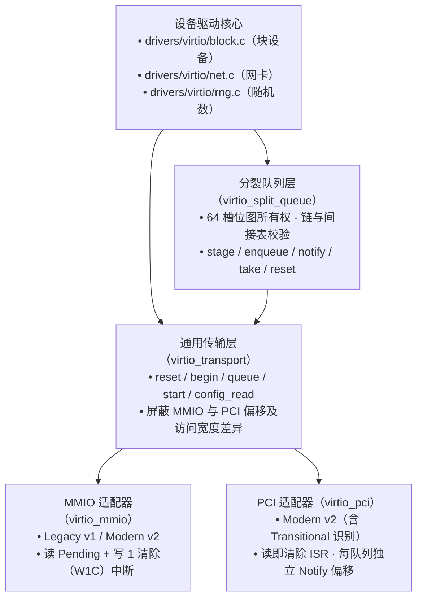
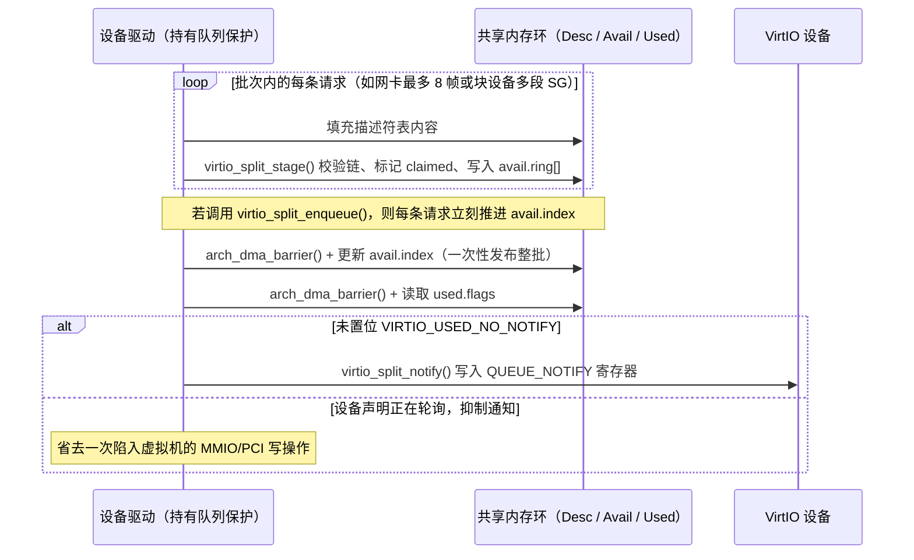

# 共用 VirtIO 传输层与分裂队列框架

虚拟输入输出设备（Virtual I/O，VirtIO）是虚拟机与客户机操作系统之间的标准半虚拟化设备协议。BoarOS 为块设备、网卡与硬件随机数生成器提炼出一套与总线无关的共用 VirtIO 框架：上层设备驱动只关注各自的数据语义与缓冲区所有权，底层总线差异（内存映射 I/O 与 PCIe 内存空间）和环形队列同步则完全收敛在传输层与分裂虚拟队列（Split Virtqueue）中。

---

## 一、分层架构与源码组织

| 源码路径 | 核心职责 |
| :--- | :--- |
| `include/kernel/virtio_transport.h`、`drivers/virtio/transport.c` | 传输层公共状态机：设备复位确认、特性位协商、状态位推进、队列注册与设备配置区安全读取 |
| `include/kernel/virtio_split_queue.h`、`drivers/virtio/split_queue.c` | 分裂虚拟队列（Split Virtqueue）：描述符链校验、可用环分阶段发布、设备通知抑制、完成环收割与故障快照 |
| `include/kernel/virtio_mmio.h`、`drivers/virtio/mmio.c` | 内存映射 I/O（Memory-Mapped I/O，MMIO）适配器：支持传统版（v1 Legacy）与现代版（v2 Modern），用于 RISC-V `virt` 平台 |
| `include/kernel/virtio_pci.h`、`drivers/virtio/pci.c` | 外设组件互连（Peripheral Component Interconnect，PCI）适配器：支持现代 PCI 能力解析、基址寄存器（BAR）分配与共享中断线，用于 LoongArch `virt` 平台 |

框架明确划分了三类职责边界：
- **平台适配层**（如 `arch/riscv/virtio_mmio_*.c`、`drivers/virtio/pci_*.c`）拥有物理总线资源、基址寄存器（Base Address Register，BAR）映射和中断控制器绑定，在设备停止后负责归还总线资源。
- **传输与队列框架**管理寄存器协议、直接内存访问（Direct Memory Access，DMA）内存屏障、描述符链合法性与设备侧完成校验，但**不分配也不释放任何物理页**，队列内存与业务缓冲区全部由设备驱动借出。
- **设备驱动核心**（块、网络、随机数）各自持有业务状态、内存池、重试策略、等待队列与超时期限。

---

## 二、传输层状态机与总线适配差异

### 2.1 设备初始化与状态推进

VirtIO 规范要求驱动按固定顺序与设备握手，避免设备在描述符环尚未就绪时就开始读取主机内存。`drivers/virtio/transport.c` 将这一过程封装为四个严格递增的状态接口：

1. **`virtio_transport_reset()`**：清除 `quiescent`、`started`、`negotiated` 标志，向状态寄存器写 `0`，执行输入输出屏障（`arch_io_barrier()`）后读回状态寄存器。只有读回 `0` 才执行 DMA 屏障（`arch_dma_barrier()`）并置 `quiescent = 1`，确认设备已彻底停止 DMA；否则返回 `VIRTIO_DEVICE`。
2. **`virtio_transport_begin(t, wanted, required, &accepted)`**：先调用 `reset()`，再依次写入 `ACKNOWLEDGE`（1）与 `DRIVER`（3）。
   - **传统版（v1）**：仅读取并协商低 32 位特性位。
   - **现代版（v2）**：读取完整 64 位特性位，并强制将第 32 位 `VIRTIO_F_VERSION_1` 加入 `wanted` 与 `required`；写入协商结果后置位 `FEATURES_OK`（状态值 11），经 I/O 屏障回读确认设备未撤回该位（否则返回 `VIRTIO_DEVICE`）。若必需特性缺失则返回 `VIRTIO_UNSUPPORTED`。
3. **`virtio_transport_queue()`**：仅在已协商且未启动状态下允许配置队列。校验队列长度（非零 2 的幂）、物理地址 16 字节对齐、可用环 2 字节对齐、已用环 4 字节对齐、三区互不重叠且不溢出 64 位地址，同时检查设备 `QUEUE_NUM_MAX` 与现代队列未提前就绪（`QUEUE_READY == 0`）。
   - **传统版（v1）**：额外校验可用环紧随描述符表（`available == 16 × size`）、已用环按页对齐且页帧号不超出 32 位，依次写入 `GUEST_PAGE_SIZE`、`QUEUE_ALIGN`，执行 DMA 屏障后写入 `QUEUE_PFN`。
   - **现代版（v2）**：分别写入描述符表、可用环与已用环的 64 位物理地址，执行 DMA 屏障后置 `QUEUE_READY = 1`。
4. **`virtio_transport_start()`**：执行 DMA 屏障并清除 `quiescent`，将状态写入 `DRIVER_OK`（现代版 15、传统版 7），经 I/O 屏障回读确认 `DRIVER_OK` 置位且未触发 `DEVICE_NEEDS_RESET`（64）或 `FAILED`（128）。

设备配置区通过 `virtio_transport_config_read()` 访问，强制检查自然对齐与 `1/2/4` 字节宽度并严格限制在 `config_size` 边界内；多字节字段的一致性重读（结合现代版的 `CONFIG_GENERATION` 寄存器）由各设备驱动按需实现。

### 2.2 MMIO 与 PCI 传输对比

| 维度 | MMIO 适配器（`drivers/virtio/mmio.c`） | PCI 适配器（`drivers/virtio/pci.c`） |
| :--- | :--- | :--- |
| **支持协议版本** | Legacy v1 与 Modern v2 | 仅 Modern v2（接受 Modern ID `0x1040..0x107f` 与 Transitional ID `0x1000..0x103f`，两者均要求完整现代 PCI 能力） |
| **设备身份识别** | 校验魔数 `0x74726976`（`"virt"`）、版本号 `1`/`2` 与 `DeviceID` | 校验厂商 ID `0x1af4`；Transitional 设备按 PCI Subsystem Device ID 区分设备类型，不靠旧设备 ID 相减 |
| **寄存器访问宽度** | 统一 32 位 MMIO 读写（配置区支持 1/2/4 字节） | 按规范自然宽度访问 Common 配置区（状态/代次 1 字节，队列选择/大小/就绪 2 字节，特性/地址 4 字节） |
| **队列通知机制** | 写入固定偏移 `0x50`（`QUEUE_NOTIFY`） | `prepare_queue()` 读取 `queue_notify_off` 并乘以 `notify_multiplier`，为每个队列独立校验并缓存 `queue_notify[q]`（上限 `VIRTIO_PCI_MAX_QUEUES = 32`） |
| **中断确认方式** | 先读 `0x60`（`InterruptStatus`），再向 `0x64`（`InterruptACK`）写 1 清除（W1C） | 读取 `ISR` 字节即自动清除（Read-to-Clear） |
| **配置区与总线控制** | 配置区固定位于 `+0x100`，长度为 `size - 0x100` | Common / Notify / ISR 三项能力必须存在，Device Config 可选（如 RNG 要求 0 字节，网卡 6 字节，块设备 8 字节）；分配内存 BAR 后先确认复位停止旧 DMA，再开启 Bus-Master 并关闭未使用的端口 I/O 解码（`(command \| 6) & ~0x401U`） |

> 传输操作表 `struct virtio_transport_ops` 在初始化时以**按值复制**保存在 `struct virtio_transport` 内，而非保存外部指针。在 RISC-V 启动早期物理别名地址阶段，`virtio_mmio_transport_initialize()` 逐项写入函数地址，确保基于当前程序计数器（PC）解析，避免引用高地址静态常量表。

---

## 三、分裂虚拟队列：描述符所有权、批量发布与收割

分裂虚拟队列由三块主机与设备共享的连续内存组成：**描述符表（Descriptor Table）** 描述数据缓冲区的物理地址与长度；**可用环（Available Ring）** 由驱动写入待处理请求头的索引；**已用环（Used Ring）** 由设备回写已完成请求头的索引及实际写入字节数。

BoarOS 的分裂队列上限为 **`VIRTIO_SPLIT_MAX_SIZE = 64`** 项，用一个 64 位位图 `claimed` 追踪当前被占用（已提交给设备且尚未收割）的描述符集合，并在 `owners[64]` 中为每条在途请求的头描述符记录不透明的业务令牌（`token`）、整条链占用的位图掩码（`mask`）以及期望完成长度的合法区间 `[min_length, max_length]`。

### 3.1 为什么索引必须自然对齐

协议规定的 `available->index` 与 `used->index` 均为 16 位无符号递增计数器。`drivers/virtio/split_queue.c` 通过 `_Static_assert` 严格约束结构体大小与对齐，**禁止使用可能导致编译器拆分为逐字节访问的 `__attribute__((packed))`**。若编译器把 16 位写操作拆成两个 8 位字节写，在索引从 `0x00ff` 跨越到 `0x0100` 时，并行运行的虚拟设备可能读到中间态 `0x0000`，误以为驱动瞬间发布了 65,000 余个请求并触发设备侧队列越界错误。自然对齐保证了单条半字读写指令的原子性，再配合内存屏障保证数据与索引的可见顺序。

### 3.2 分阶段发布与通知抑制

为了兼顾单请求直发与高吞吐合批，分裂队列将“登记链”、“更新可见索引”与“写寄存器通知设备”解耦为三个层次：

- **`virtio_split_stage()`**：校验描述符链无越界、无环路、无非法标志、无 64 位地址溢出、无与在途链冲突；若使用间接描述符表（`VIRTIO_DESC_INDIRECT`，bit 2，需协商特性 bit 28），额外校验其为独立头项且表地址/长度按 16 字节对齐。校验通过后登记 `owners[head]`、置位 `claimed` 并写入 `available->ring[]`，**但暂不推进设备可见的 `available->index`**。
- **`virtio_split_enqueue()`**：等价于 `stage()` 后立即执行 DMA 屏障并推进 `available->index`（块设备用于在多请求发布期间让设备提前消费，最后统一通知）。
- **`virtio_split_notify()`**：先发布尚未同步的 `next_available` 到 `available->index`，再执行一次 DMA 屏障并读取 `used->flags`；若设备未置位 `VIRTIO_USED_NO_NOTIFY`（bit 0），才写入 `QUEUE_NOTIFY` 触发虚拟机退出通知设备。
- **`virtio_split_publish()`**：`enqueue()` 与 `notify()` 的组合快捷入口（供 RNG 等单请求设备使用）。

### 3.3 批量完成收割、令牌隔离与复位回收

- **收割模式**：`virtio_split_take()` 每次读取 `used->index` 并执行 DMA 屏障后取出一条完成项；高吞吐驱动（如网卡）可在单次锁保护内先调用 `virtio_split_completion_index()` 快照当前完成前缀边界，再用 `virtio_split_take_before()` 连续收割该前缀内的所有完成项，避免每包重复读共享索引与插入屏障。
- **令牌与缓冲区解耦**：收割通过后，框架清除该请求链在 `claimed` 中的全部位并返回不透明的 `token`、头描述符编号与实际完成长度；框架**绝不解引用 `token`**，也**不释放业务缓冲区、网卡接收借用或协议 `pbuf`**，所有业务对象继续由驱动核心管理。
- **故障隔离与复位前提**：若设备返回超出队列长度的完成数（`VIRTIO_QUEUE_OVERFLOW`）、无效或未在途的头编号（`VIRTIO_QUEUE_BAD_HEAD`）或越界完成长度（`VIRTIO_QUEUE_BAD_LENGTH`），框架立即在 `q->fault` 中冻结现场并返回 `VIRTIO_DEVICE`，已收割的合法完成项不受影响。后续只有当**同一绑定传输层**已确认复位完成（`t->quiescent == 1 && !t->started`）后，`virtio_split_reset()` 才允许清空残留令牌与环索引，杜绝设备 DMA 尚未停止就复用缓冲区的竞态。

---

## 四、已接入设备概览

| 设备模块 | 接入形态 | 队列配置 | 详细文档 |
| :--- | :--- | :--- | :--- |
| **VirtIO 块设备** | RISC-V MMIO (v1/v2) · LoongArch PCI (v2) | 单队列（最多 64 描述符、8 请求槽），支持散列-聚集（SG）与分阶段写入 | [VirtIO 块设备与通用块层](riscv-virtio-block.md) |
| **VirtIO 网卡** | RISC-V MMIO (v1/v2) · LoongArch PCI (v2) | 双队列（RX/TX 各 32 描述符、64 槽池），支持间接表零拷贝发送与接收借用 | [VirtIO 网卡与以太网数据路径](riscv-virtio-net.md) |
| **VirtIO 随机数** | RISC-V MMIO (v1/v2) · LoongArch PCI (v2) | 单队列（1 描述符、64 字节数据区），独立内核线程周期性为熵池补种 | [VirtIO 硬件随机数与熵源初始化](riscv-virtio-rng.md) |

---

展开查看：错误码语义、PCI 失败回收契约与定向验证入口

### 错误码语义（`enum virtio_status`）

| 状态码 | 含义 |
| :--- | :--- |
| `VIRTIO_OK` | 操作成功 |
| `VIRTIO_INVALID` | 调用参数、对齐、地址范围或配置偏移非法 |
| `VIRTIO_UNSUPPORTED` | 设备版本、必需特性、队列容量或 PCI 通知范围不受支持 |
| `VIRTIO_NO_MEMORY` | 缺少 PCI BAR 窗口等资源 |
| `VIRTIO_DEVICE` | 设备拒绝复位、`FEATURES_OK`、`DRIVER_OK`，或完成环出现损坏 |
| `VIRTIO_TIMEOUT` | 保留给设备业务核心报告超时（框架本身不管理时钟与期限） |
| `VIRTIO_STATE` | 状态机违反前提（如启动后改队列、队列故障后继续提交、未确认复位即重置队列） |
| `VIRTIO_EMPTY` / `VIRTIO_FULL` | 完成环为空 / 可用队列已满（或 PCI 槽位无匹配设备） |

### PCI 失败所有权与销毁顺序

- 初始化在分配并映射 BAR 后、开启 Bus-Master 前先执行 `virtio_transport_reset()` 确认残留 DMA 已停；若此时复位失败，函数返回错误但**保留 `pci_function` 与 BAR 所有权**，不恢复可能仍有 DMA 活动的旧配置，留待后续显式重试销毁。
- 正常销毁顺序必须先由业务核心排空/归还所有 DMA 缓冲区与业务对象并注销中断，再由 `virtio_pci_transport_destroy()` 再次确认设备复位并调用 `pci_function_restore()` 恢复原始 BAR 与命令寄存器。
- 块设备 PCI 包装层（`struct virtio_pci_block`）通过 `core_owned` 精确记录核心是否已接管队列页，确保初始化中途失败的半成品也能安全回收且不会重复释放队列。
- 同步复位契约基于固定 QEMU v11.1.0 行为（写状态 `0` 后同步完成 `blk_drain` 等清理）；块设备在无法确认复位时触发内核致命中止以保护借用的调用者内存，网卡与随机数设备则向平台返回 `-EIO` 保留所有权以便后续重试。

### 定向验证入口

- **宿主框架与总线模型**：`make test-virtio-framework-host`、`make test-virtio-block-host`、`make test-pci-host`（覆盖特性/复位失败、三类适配器访问宽度与通知偏移校验、令牌与描述符分离、跨设备复位拒绝、链环路/冲突、间接表、反序/重复完成与 65,544 次 16 位索引绕回）。
- **双架构客机与故障注入**：`make test-block-riscv`、`make test-block-loongarch`、`make test-io-sleep-riscv`、`make test-root-loongarch`、`make test-pci-reset-owner-loongarch`、`make test-root-io-loongarch`。
- **栈占用与数据库恢复回归**：`make test-stack-usage`、`make test-stack-usage-la`、`make test-sqlite-recovery-matrix-riscv`、`make test-sqlite-wal-recovery-matrix-riscv`。

