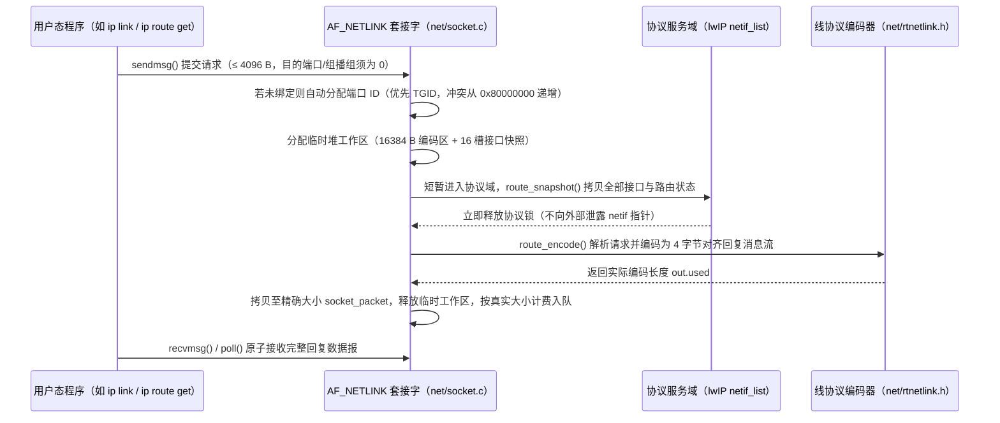

# 只读 rtnetlink 路由与接口查询子系统

在 Linux 网络管理体系中，`iproute2` 工具集（如 `ip link`、`ip addr`、`ip route`）并不直接读取内核数据结构，而是通过一种面向数据报的内核-用户态通信套接字——**Netlink**（地址族 `AF_NETLINK`，协议 `NETLINK_ROUTE`，简称 `rtnetlink`）——收发采用 4 字节对齐的**类型-长度-值（Type-Length-Value，TLV）**消息来查询网络接口、IP 地址与路由表。

BoarOS 实现了只读 `NETLINK_ROUTE` 查询引擎，直接服务未修改的静态 `iproute2` 等现代网络工具，同时保持零热路径开销：仅在用户态发起查询请求时短暂采样网络接口快照，不在普通 TCP/UDP 收发路径增加任何新锁、缓存失效或统计字段。整体网络架构见[多核网络协议栈与套接字](modules/kernel-network.md)，底层接口与修改控制见[VirtIO 网卡与以太网数据路径](modules/riscv-virtio-net.md)。

---

## 一、源码组织与架构流程

| 源码路径 | 核心职责 |
| :--- | :--- |
| `net/rtnetlink.h` | 只读 `rtnetlink` 线协议编解码器：消息头与属性（`rtattr`）4 字节对齐编码、三类 Dump 导出、IPv4 路由点查询与标准 `NLMSG_ERROR` 构造 |
| `net/socket.c` | `AF_NETLINK` 套接字生命周期、端口绑定与自动分配、请求入场校验、协议域快照采样（`route_snapshot`）与精确配额入队（`netlink_send`） |

---

## 二、套接字语义、绑定与消息复用

`AF_NETLINK` / `NETLINK_ROUTE` 支持 `SOCK_RAW` 与 `SOCK_DGRAM` 两种类型，完全复用内核套接字子系统既有的有界消息队列、`poll`/`epoll`、`recvmsg`、`MSG_PEEK`、`MSG_TRUNC` 与打开文件描述生命周期，并与 POSIX 消息队列异步通知（`mq_notify(SIGEV_THREAD)`）的 32 字节通知凭证（`NETLINK_COOKIE_SIZE = 32`）无缝共存（见[POSIX 消息队列模块](modules/posix-mqueue.md)）。

- **端口绑定（`netlink_bind`）**：支持显式绑定唯一非零端口 ID（冲突返回 `-EADDRINUSE`），也支持自动绑定（显式传 `0` 或在未绑定状态下直接发送时自动触发）。自动绑定优先选用当前线程组标识（TGID），若已被占用则从 `0x80000000` 起顺序分配独立端口 ID。
- **通信方向限制**：所有内核回复的源地址端口均为 `0`（代表内核），消息头 `nlmsg_pid` 填入接收套接字的本地端口 ID。用户态发送时若指定目标地址，地址族必须为 `AF_NETLINK`（否则 `-EINVAL`），且目标端口与组播组掩码必须为 `0`（不支持用户态互发单播或 Netlink 组播，违者返回 `-EPERM`）；附带控制消息或凭据辅助数据返回 `-EINVAL`。

---

## 三、支持的消息类型与数据导出语义

所有消息头与属性均按 4 字节对齐并清零填充字节，完整回传请求序列号 `nlmsg_seq`。全量遍历（Dump，即请求标志含 `NLM_F_DUMP = 0x300`）的每条回复均携带 `NLM_F_MULTI`（`2`）并以状态 `0` 的 `NLMSG_DONE`（类型 `3`）结尾；单条点查询若请求了 `NLM_F_ACK`（`4`），则在正常回复后追加错误码为 `0` 的 `NLMSG_ERROR`（类型 `2`）。

| 请求类型 | 支持模式与地址族 | 导出的真实内核状态 |
| :--- | :--- | :--- |
| **`RTM_GETLINK`（18）** | 全量 Dump；按接口索引 `ifi_index` 或名称 `IFLA_IFNAME` 点查询 接受 `AF_UNSPEC`、`AF_INET`、`AF_INET6`、`AF_PACKET` | 接口名、接口索引、硬件类型（回环 `772` / 以太网 `1`）、MAC 地址、广播地址、MTU（回环逻辑 `65536`）、标志（`UP`/`RUNNING`/`LOWER_UP`）、运行状态（`operstate`）；内核无流量整形队列（qdisc），固定导出 `noqueue` 与 `txqlen = 0`，不伪造统计计数 |
| **`RTM_GETADDR`（22）** | 仅全量 Dump（非 Dump 返回 `NLMSG_ERROR(-EOPNOTSUPP)`） 接受 `AF_UNSPEC`、`AF_INET`、`AF_INET6` | **IPv4**：单接口地址、掩码前缀长度、接口标签与非回环广播地址 **IPv6**：最多 5 槽（槽 0 为回环/链路本地地址，槽 1~4 为 2 个静态与 2 个无状态自动配置 SLAAC 地址），导出真实前缀、标志（`tentative`/`dadfailed`/`deprecated`；动态地址不标 `PERMANENT`）及 `IFA_CACHEINFO`（首选/有效寿命与创建/更新时间戳） |
| **`RTM_GETROUTE`（26）** | 全量 Dump（`UNSPEC`/`INET`/`INET6`）+ **IPv4 点查询（`ip route get`）** | **IPv4**：直连子网路由（`main` 表 254）、本机/回环地址路由（`local` 表 255）及已配置的唯一默认网关 **IPv6**：链路本地/静态地址的 `local /128` 与去重后的直连前缀路由（静态地址 metric `256`）、显式默认网关（protocol `3`、metric `1024`），以及路由通告（RA）学到的最多 5 条链路前缀（metric `256`）与 3 条默认路由器（protocol `9`、metric `2048`、含 `RTA_PREF` 优先级及以 100 Hz `USER_HZ` 计量的 `RTA_CACHEINFO` 剩余有效期） |

> 仅自动配置（A-only）而未标记在链（On-link）的 IPv6 SLAAC 地址只导出 `local /128` 路由，不虚构直连 `/64` 路由；处于试探态（`tentative`）或地址冲突（`dadfailed`）的 IPv6 地址不生成可用路由。

### IPv4 路由点查询（`ip route get`）规则

点查询（`route_lookup()`）严格忠实于当前 `lwIP` 协议栈的实际选路行为，而不是虚构一套内核并不存在的最长前缀转发表（FIB）：
- **匹配顺序**：按接口快照顺序挑选首个处于 `UP`、`link-up` 且拥有有效 IPv4 地址的匹配接口：依次检查本机/回环地址（标记为 `local`）、同网段直连目标、全局默认网关。
- **支持属性**：接受目的地址 `RTA_DST`（1）、源地址 `RTA_SRC`（2，须为本机已配置地址或回环子网地址）、出接口 `RTA_OIF`（4，不存在返回 `-ENODEV`，未就绪返回 `-ENETUNREACH`）与用户标识 `RTA_UID`（25，无策略路由规则，接受但不影响选路）。
- **显式出接口与表分类**：指定 `RTA_OIF` 访问非直连目标时，该接口仍须已配置网关，否则返回 `-ENETUNREACH`（不合成 Linux 的隐式 on-link 路由）。支持 `RTM_F_LOOKUP_TABLE`（`0x1000`）按真实路由归属返回 `local`（255）或 `main`（254）表；普通回复为 `/32` 解析路由，不带 `MULTI`/`DONE`。

---

## 四、快照隔离与有界内存配额

为防止路由查询拖慢数据面或造成内存膨胀，`netlink_send()` 在资源管理上遵循三项约束：

1. **瞬时快照、零长持锁**：在单次进入协议域内通过 `route_snapshot()` 将所有接口状态复制到临时缓冲区（上限 **`ROUTE_SNAPSHOT_MAX = 16`** 个接口），立即释放协议锁后再执行纯内存的 TLV 编码，队列中只保留不可变字节流，绝不持有 `netif` 指针。
2. **显式上限、绝不静默截断**：单次请求上限 **`4096 B`**（超限返回 `-EMSGSIZE`），单次编码工作区上限 **`ROUTE_RESPONSE_MAX = 16384 B`**（接口数或回复超出上限直接返回 `-ENOBUFS`，绝不输出残缺却看似成功的 Dump）。
3. **精确计费与原子交付**：编码完成后，内核立刻将实际生成的 `out.used` 字节拷贝到精确大小的 `socket_packet` 中并释放临时 16 KiB 工作区，随后按真实包体积向 `socket->record_memory` 计费（受 `socket->rx_limit` 约束，且与 POSIX MQ 通知配额独立）。一次发送产生的全部回复消息（含 `MULTI` 与 `DONE`）以单个数据报原子入队，避免多进程并发共享同一套接字时消息交错；关闭套接字时逐包按实际大小归还配额。

---

展开查看：错误处理契约与定向验证入口

### 严格拒绝与错误处理契约

| 场景 | 返回错误或处理方式 |
| :--- | :--- |
| 请求尾部不足完整 16 字节 `nlmsghdr` 或 `nlmsg_len` 越界 | 按 Netlink 分帧规范丢弃畸形尾部 |
| 请求体短于最小载荷或 `rtattr` 长度/填充非法 | `NLMSG_ERROR(-EINVAL)`（回显原请求头与原载荷） |
| 未知或不支持的请求类型（如增删改路由/地址） | `NLMSG_ERROR(-EOPNOTSUPP)` |
| 非 Dump `RTM_GETLINK` 未命中接口 / 点查询 `RTA_OIF` 不存在 | `NLMSG_ERROR(-ENODEV)` |
| IPv4 点查询携带非零 `IIF`、`MARK`、`TOS`、额外表/标志、多播/广播目的、未知属性，或发起 IPv6 点查询 | `NLMSG_ERROR(-EOPNOTSUPP)`（绝不静默忽略未知选择器） |
| IPv4 点查询无可达路径或源地址不属于本机 | `NLMSG_ERROR(-ENETUNREACH)` |
| `shutdown(2)` 用于 `AF_NETLINK` 套接字 | `-EOPNOTSUPP` |

### 定向验证入口

- **宿主全链路测试（4 KiB 与 16 KiB 页配置）**：
  - `sh tests/host/rtnetlink.sh`（覆盖 FD/OFD/套接字/堆所有权、绑定冲突、三类 Dump、序列号、`MULTI`/`DONE`、点查询与选择器拒绝、ACK/错误回显、截断、接收配额与混合 MQ 关闭）
  - `FILE_IO_HOST_SHIFTS='12 14' sh tests/host/netlink-notify.sh`
- **双架构客机与真实 `iproute2` 验证**：
  - 使用 `tests/userland/rtnetlink.py` 运行 `tests/workloads/network/rtnetlink.c` 与静态 `iproute2`（`ip link show`、`ip address show`、`ip route show table all`、`ip -6 address show`、`ip -6 route show`、`ip route get 127.0.0.1`、`ip route get 192.0.2.1 [oif eth0]`），覆盖多进程共享套接字并发查询、动态切换接口 UP/DOWN 与增删网关后的实时响应。

