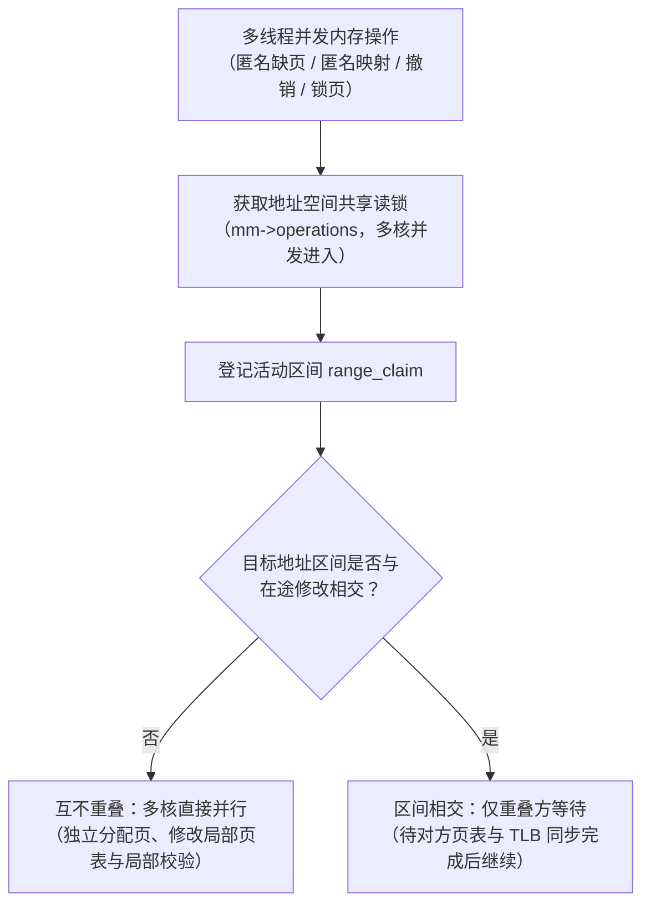
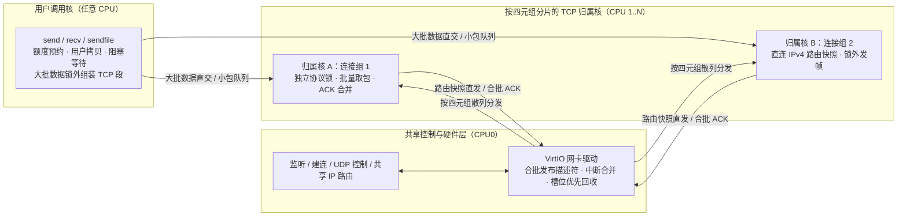

# BoarOS 性能工程与关键优化

操作系统性能优化最容易陷入两个误区：一是凭直觉“盲改”，在只占总耗时极小比例的局部路径上做微调；二是以牺牲并发正确性或持久化语义为代价换取纸面跑分。

BoarOS 建立了一套**“内置归因观测 → 瓶颈结构拆解 → 架构级消除重复工作与串行化 → 严格同口径对照验证”**的性能工程体系。本文系统介绍这套方法论，以及我们在调度、虚拟内存、文件系统、网络与驱动五大核心数据路径上落地的代表性优化设计。

---

## 一、性能工程方法论与内置归因体系

### 1.1 为什么需要内置成本归因（`COST_DIAGNOSTICS`）

面对一个运行偏慢的真实负载（例如大规模文件编译、数据库事务或高并发网络传输），仅仅看到“总耗时变长”往往无法判断真正瓶颈在哪里：是系统调用进入太频繁？是某把锁在多核下剧烈争用？是线程被唤醒后迟迟拿不到处理器？还是都在等磁盘或网卡硬件完成？

为此，BoarOS 在内核中设计了编译期可选的成本观测框架 **`COST_DIAGNOSTICS`**（默认发布构建完全关闭，零运行开销；诊断构建通过 `/proc/boaros_cost_control` 精确划定起止窗口，经 `/proc/boaros_cost` 导出结构化快照）。它将内核开销沿两个正交维度拆解：

1. **五类时间归因**：严格区分 **实际 CPU 执行时间**、**锁等待时间**、**业务排队时间**、**设备 I/O 等待时间** 以及 **唤醒后等待调度的就绪延迟（wake-to-run）**。
2. **前景与背景分离**：同时分别统计目标进程组的前台耗时与内核后台线程（如页缓存写回、ext4 日志提交、网络收发工作线程）的实际工作量，避免“把写回推给后台就误以为写入零开销”。

### 1.2 三条核心分析原则

- **先消重复，再做批处理，最后调参数**：读调用链时优先找出因嵌套循环被放大的重复查表、重复加锁、重复内存拷贝与重复唤醒；能在同一次请求或相邻请求间安全复用的解析结果（如路径提示、路由快照、有效页表槽）先复用，必要成本再通过批处理摊薄。
- **区分“次数变化”与“单次成本变化”**：利用 `总 CPU 消耗 ≈ 调用次数 × 平均独占耗时`，在版本对比时明确一项改动究竟是减少了触发频次，还是缩短了单次处理路径。
- **以真实完成边界为准**：存储测试严格区分 **`write` 缓存接纳返回** 与 **`fsync` 落盘完成**；网络测试以接收端完整校验所有字节为完成标准；多核加速比严格使用同一内核、同一总工作量的单核耗时除以多核耗时。

---

## 二、调度、同步与线程生命周期优化

### 2.1 等待原语的代次无锁快路径

- **瓶颈现象**：高并发管道、套接字或锁同步中，经常出现“等待线程刚登记完等待条件、正准备切出处理器休眠，唤醒方已经把数据送达”的竞态窗口。传统实现中，即使唤醒早已到达，等待线程仍要再次获取全局调度锁去提交阻塞状态并立即解除。
- **设计改造**：`kernel_wait_prepare()` 为每次等待分配全局单调递增的**代次令牌（Generation Token）**，并将代次、等待阶段（`PREPARED` / `COMMITTED` / `NOTIFIED`）和唤醒原因合并在一个原子字中。如果唤醒方在等待线程尚未提交阻塞前就到达，可直接通过原子状态跃迁将其置为 `NOTIFIED`；等待线程进入 `park` 时只需读取原子状态即可直接返回，完全跳过全局调度锁和上下文切换。
- **正确性保障**：单调不回退的代次确保旧唤醒、重复唤醒以及内存复用后的残留通知全部自动失效，第一次成功的唤醒、超时或信号中断原子决定最终返回原因。

### 2.2 亲和性感知的 O(log N) 跨核窃取

- **瓶颈现象**：多核调度器在空闲核尝试从其他繁忙核“窃取”就绪任务时，如果线性遍历对方队列逐一检查每个任务的处理器亲和性（CPU Affinity）与迁移资格，队列较长时持锁时间会随任务数线性膨胀。
- **设计改造**：
  - 普通任务在每核公平调度平衡树（AVL 树）的每个节点上，同步维护**整棵子树允许迁移的目标处理器位图**。空闲核加锁查找时，遇到不支持当前核的子树直接整枝剪掉，按虚拟运行时间顺序快速定位可运行候选。
  - 实时任务同样在来源核按优先级与同级先入先出顺序构建可迁移索引树，汇总子树亲和性与优先级继承（Priority Inheritance，PI）资格，查询最多沿两条树路径完成。
- **正确性保障**：任务刚进入队列但旧执行核尚未完成切栈前，不会赋予可迁移候选资格，彻底防止跨核栈踩踏。

### 2.3 可睡眠读写锁的有界自适应自旋

- **瓶颈现象**：保护内存区域或文件元数据的可睡眠读写锁（`kernel_rwlock`）在大多数时候临界区非常短。如果在多核下只要锁被占用就立刻让线程睡眠切换，保存现场、切栈、再被唤醒等待调度的开销往往远大于持锁本身的时间。
- **设计改造**：在多核环境下，若等待者排在锁的先入先出等待队列队首且独占写者正在另一颗核上活跃运行，等待者在锁外恢复中断并进行**有界自适应自旋**（基础上限 50 µs，队首且写者处于活跃运行状态时上限 1 ms），一旦轮询到资格标记便直接进入临界区；对于排在队尾、下一次释放也轮不到它的后继写者，则直接睡眠让出处理器，避免无意义的算力空转。

### 2.4 带保护页的每核内核栈缓存

- **瓶颈现象**：频繁创建与销毁短生命周期线程（如编译构建、并行测试）时，每次创建线程都要分配物理栈页、修改内核页表建立带防溢出保护页（Guard Page）的映射，销毁时又要撤销映射并触发跨核转换后备缓冲器（Translation Lookaside Buffer，TLB）失效同步，固定开销极高。
- **设计改造**：每个处理器核保留一个已退役用户任务的内核栈及其现成的虚拟映射与保护页。回收者确认旧任务已完全切离该栈且所有等待借用归零后，通过原子交换发布至本核栈缓存；下次创建线程直接复用该映射，省去页表修改与跨核 TLB 同步。当物理内存紧张时，分配器压力钩子可安全摘除缓存栈并归还物理页。

---

## 三、虚拟内存管理（VMM）优化

### 3.1 区间认领（`range_claim`）：打破进程级地址空间大锁

- **瓶颈现象**：多线程程序共享同一个地址空间（`mm`）。如果 `mmap`（内存映射）、`munmap`（解除映射）、`mprotect`（修改权限）和缺页中断全部争抢同一把进程级独占大锁，线程数越多，多核扩展性越差。
- **设计改造**：BoarOS 为每个地址空间构建了三层细粒度并发协议：
  1. 外层 **`record->operations` 读写锁**：不固定地址的私有匿名映射、纯匿名撤销、权限提升、内存锁定与缺页初查均可获取**共享读锁**并行进入；仅涉及全局布局重排（如 `fork`、`mremap`、固定地址覆盖替换）才获取独占写锁。
  2. 中层 **活动区间认领（`struct kernel_mm_range_claim`）**：在极短元数据自旋锁保护下登记当前正在操作的虚拟地址区间 `[start, end)`。互不重叠的地址区间可并行推进页表修改与缺页，仅当区间相交时才等待排他协调。
  3. 局部校验机制：私有匿名缺页在最终写入硬件页表前，只核对目标地址对应虚拟内存区域（Virtual Memory Area，VMA）的一致性与区间冲突，其他线程在无关地址上的映射增删不会引发假冲突重试。

### 3.2 批量页表项发布与合并跨核 TLB 同步

- **瓶颈现象**：加载大型可执行文件或顺序读取内存映射文件时，如果每次缺页只安装 1 个 4 KiB 页表项，程序每前进 4 KiB 就要陷入一次内核异常、查一次 VMA、遍历一次三级页表；同样，`fork` 与大范围 `munmap` 逐页修改和逐页发远程 TLB 刷新也会造成严重的跨核风暴。
- **设计改造**：
  - **64 KiB 窗口邻页批量发布**：处理普通文件或 ELF 代码段缺页时，完成需求页装入后，在同一 VMA 的 64 KiB 窗口内只遍历一次上层页表，扫描连续空叶槽，将已经在页缓存中就绪的邻页成批安装为只读/写时复制页表项，单次陷入即可覆盖多页访问（若程序通过 `madvise(MADV_RANDOM)` 声明随机访问模式，则自动关闭推测预装）。
  - **16 项批处理与合并退休**：`fork` 克隆页表、写保护设置以及 `munmap` 解除映射均按叶表内最多 16 个相邻项批量借用物理页引用或收集退休页；大范围撤映射时合并多个退休批次，只发起一次跨核 TLB 失效确认，再统一归还物理页。
  - **按需延迟刷新**：RISC-V 在支持 `Svvptc` 语义或共享文件页从只读升级为可写（物理页未变）时，避免发送不必要的全局远程刷新——其他核若偶发命中旧只读缓存触发缺页，在核对当前页表项已可写后就地刷新本核 TLB 重试即可。

### 3.3 RISC-V 本核直接用户内存拷贝（Direct SUM）

- **瓶颈现象**：`read`/`write` 和路径字符串导入等高频系统调用每次都要在内核态与用户态间拷贝数据。如果每次拷贝都逐页查软件页表、固定物理页、转换成内核直映地址、拷贝后再解除固定，小尺寸系统调用的软件翻译开销占比极高。
- **设计改造**：在 RISC-V 上，当访问当前已激活线程自身的地址空间时，汇编例程（`arch/riscv/user_copy.S`）仅在实际执行用户访存指令的极短区间临时开启监管者访问用户内存位（`SUM`），直接对用户虚拟地址执行读写；同时为每条访存指令登记精确的异常恢复地址表。
- **正确性保障**：一旦触发缺页，异常入口立即清除 `SUM` 并安全跳转到恢复路径，记录精确的已完成字节前缀，再退回到常规缺页解析器按需装页后重试；遇到非法地址则准确返回 `EFAULT`（坏地址错误），且绝不会在陷入帧之下嵌套复杂文件 I/O。

---

## 四、虚拟文件系统（VFS）与 ext4 存储优化

### 4.1 路径解析零拷贝与三级热路径缓存

路径查找（如频繁执行 `stat`、`open`、编译器查找头文件）是操作系统元数据最热的入口。BoarOS 沿整条查找链消除了四类重复工作：

1. **零拷贝分量比对**：目录项查找直接基于调用者路径文本的起止切片做长度与字节比对，只有真正新建目录项时才分配并复制名称字符串；中间目录遍历复用栈上的两个调用期临时槽位，避免逐层动态申请和释放路径包装对象。
2. **父目录最近命中提示（Fast Hint）**：每个父目录项记录最近一次命中的子项，重复访问公共路径前缀（如 `/usr/include/...`）可直接单次命中，未命中再回退到有序子项索引树。
3. **正目录项与属性代次缓存**：为活跃目录、普通文件和符号链接维护有界正缓存（随物理内存自动伸缩在 16～8,192 项），并按修改代次在活跃 `inode` 上复用已校验的基本属性与默认 ACL 缺失结论，避免连续 `stat` 反复读取磁盘 `inode`。
4. **目录短名缺失负缓存**：对于反复查找却不存在的文件（例如编译器沿 `-I` 搜索路径试探头文件），ext4 在活跃目录的既有映像内无额外堆分配地保留近期确认缺失的短文件名记录，目录版本未变时直接返回 `ENOENT`，无需再次读盘扫描目录块。

### 4.2 多核 ext4 目录级并行与块组位置缓存

- **瓶颈现象**：传统嵌入式 ext4 实现（如原生 `lwext4`）假定单线程访问，整个文件系统挂载共用一把全局锁，多核下并发读写不同目录会完全串行。
- **设计改造**：
  - **目录级并行锁**：在多核可写日志 ext4 挂载上，路径查找与目录枚举仅获取目标目录的**共享读锁**，创建与删除仅获取父目录的**独占写锁**；跨目录 `rename` 则按拓扑互斥与 `inode` 编号严格升序锁定涉及目录，保证不同目录间的并发操作互不阻塞且无死锁。
  - **块组索引节点表位置缓存**：挂载后按块组缓存经校验和验证的 `inode` 表起始块号（每组仅占 8 字节），后续冷装入 `inode` 时直接复用该位置，省去反复读取和校验块组描述符的开销。
  - **延迟分配与预读/写回窗口合批**：4 KiB 页配置下默认采用 **64 KiB 顺序预读窗口（RA16）** 与 **128 KiB 写回批次（WB32）**，空洞写入先做延迟分配预留，写回时合并为连续物理区段（Extent）一次提交；同时日志提交线程与检查点线程按挂载与在线核数选核，同阶段元数据修改分组直接发布给对应日志所有者。

---

## 五、多核网络协议栈与 VirtIO 驱动优化

原生 `lwIP` 是一个单线程无锁协议栈，如果简单套上一把全局大锁接入多核内核，所有 TCP/UDP 连接都会在单核或全局锁上严重拥堵。BoarOS 对协议栈接入层与虚拟网卡驱动进行了全链路多核重构：

### 5.1 已建立 TCP 连接按归属核分片并行
- 主动连接完成握手、被动连接完成 `accept` 后，按四元组散列分配至固定的**TCP 归属核**（默认首选核已有 4 条活动连接时自动均衡到负载更轻的核），每核拥有独立的 TCP 协议互斥锁、输入报文环与执行线程。
- 用户态读写（`read`/`write`/`sendfile`/`sendmmsg`）的数据拷贝、收发额度预约与阻塞等待全部留在**调用核**执行；发送至少 2 个最大报文段长度（Maximum Segment Size，MSS）的数据时，调用者在分片锁外直接把用户数据组装成最终协议缓冲区与报文段，大幅缩短分片锁的持有时间。

### 5.2 批量接收、相邻纯 ACK 合并与单包发送存储合一
- **批量取包与 ACK 合并**：归属核执行线程一次从入包队列取出最多 4 个报文，释放队列锁后再顺序推进协议状态机；在同一批次内，同一连接连续到达的纯确认报文（无 TCP 选项、确认号严格递增、通告窗口不变）会被合并处理，一次摘除所有已确认的发送段并合并触发一次可写唤醒，且生成的纯 ACK 回复也复用网卡发送合批。
- **发送描述符与缓冲区合一**：普通 TCP 发送的数据段描述符与报文缓冲区分配在同一块协议堆内存中，减少一半的内存分配与释放次数；同时软件互联网校验和采用 32 位对齐字累加至 64 位累加器的方式加速计算。

### 5.3 IPv4 直连路由快照复用与回环零排队直交
- **直连路由快照**。符合条件的 IPv4 直连发送可以缓存已解析的出接口、最大传输单元（Maximum Transmission Unit，MTU）和链路层地址。发送时先核对路径代次及本次报文条件。对于可以在调用核接纳的 UDP 单播发送，内核复用快照直接构造并提交以太网帧，省去共享路由保护内的重复查询。条件变化或本地接纳失败时，发送请求回到常规协议路径。详见 [多核网络协议栈](modules/kernel-network.md)。
- **本机回环快路径**：本机回环（`127.0.0.1` / `::1`）连接默认采用 8 KiB 大 MSS，且通信双方自动分配到同一归属核并建立双向快速关联；发包时直接借用不可变载荷视图投递到对端入包环，跳过完整 IP 路由与重复拷贝。

### 5.4 VirtIO 虚拟网卡驱动的合批与中断收敛
- **通知边界合批**：多个待发 TCP 帧在 VirtIO 发送环中连续写入后，在批次结束点统一执行一次内存屏障与设备门铃通知，显著降低虚拟机退出（VM-Exit）次数。
- **收包轮询与中断合并**：多核收包轮询期间屏蔽冗余完成中断，持续收割已到达的接收帧并复用完成环索引；收割发送完成时先优先回收空闲发送槽位再释放载荷缓冲区，避免短暂槽位耗尽阻塞高吞吐流。

---

## 六、受控对照实验工具与复现纪律

为了确保所有性能优化都经得起独立复核，仓库保留了三套覆盖存储、网络与调度记账的**固定工作量实验执行器**（详见 [数据路径实验工具](learning/data-path-budget-experiments.md) 与 [CPU 记账测量](learning/cpu-accounting-cost.md)）：

| 实验入口 | 覆盖场景 | 关键观测与验收口径 |
| :--- | :--- | :--- |
| `tests/cost/io-budget-experiment.py` | 顺序追加、覆写、冷热读、并行追加、范围修改、`writev`、`mmap` 写、混合读写 | 分别报告 `cache` 接纳吞吐、`fsync`/`fdatasync` 持久化完成吞吐、尾延迟、进程 CPU 与文件系统完整性检查 |
| `tests/cost/network-budget-experiment.py` | 回环与虚拟网卡（TAP）下的阻塞/非阻塞收发、大块吞吐、请求响应、大流与控制流混合 | 接收端逐字节校验通过后计完成，同时核对控制连接在大流量期间的实际推进情况 |
| `tests/cost/accounting/cost.py` | 固定工作量计算、定时器到期精度与多核扩展性 | 统计实际 CPU 记账开销、定时器迟到分布及单核与多核同工作量加速比 |

所有正式性能对比均遵循严格纪律：**基线与候选内核复用同一个测试 ELF 与原始磁盘镜像、关闭 `COST_DIAGNOSTICS`、串行独立启动至少三次取完整分布、绝不拿单次带诊断开销的采样当作最终性能结论。**
