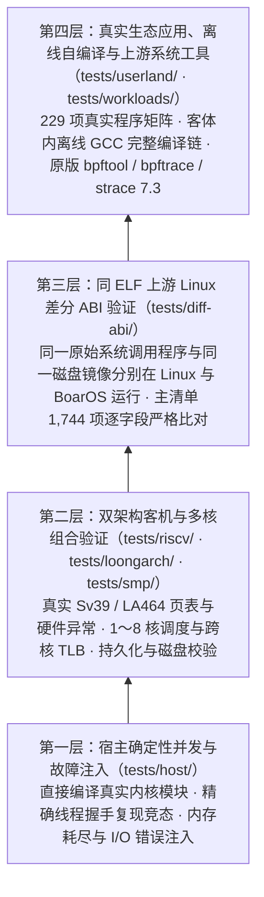
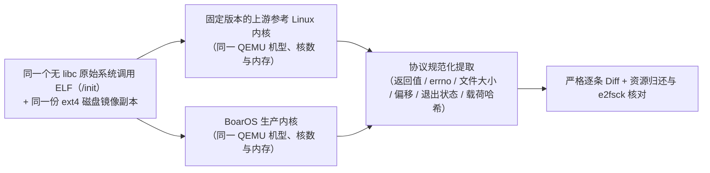

# BoarOS 正确性保证与四层验证体系

对于兼容 Linux 应用二进制接口（Application Binary Interface，ABI）的多核操作系统而言，仅仅“能跑通几个演示程序”远远不足以证明内核的可靠性——并发竞态、内存泄漏、错误码顺序偏差、异常路径回滚遗漏以及文件系统断电一致性缺陷，往往只在极端交错或真实复杂软件中才会暴露。

BoarOS 构建了一套**自底向上、逐层递进的四层自动化验证体系**，把抽象的“兼容性与并发正确性”转化为可重复、可审计、可对标上游 Linux 的客观证据。

---

## 一、四层验证金字塔总览

贯穿这四层验证的三条统一验收底线：
1. **反例优先，拒绝脆弱时序**：并发测试使用确定性同步握手（而非随机 `sleep`）精确制造交错，确保每一次“先唤醒后阻塞”“并发首缺页”“写回中再次写入”都能稳定复现。
2. **资源归还零容忍**：每次客机与宿主测试结束时，强制审计内核堆存活对象归零（`heap-live = 0`）、物理页帧回归基线、文件描述符与映射引用完全闭合。
3. **文件系统一致性与恢复核验**。客机从测试模板生成的独立副本启动，正常退出后，涉及存储的验证入口用 `e2fsck -fn` 只读检查运行副本。恢复专项在选定的写入位置注入中断，随后用内核文件系统实现重新打开受影响的副本并重放日志，核对文件内容和目录状态，再执行一致性检查。

---

## 二、分层验证详解

### 第一层：宿主确定性并发交错与故障注入

许多关键的内核缺陷（例如物理内存耗尽时的半成品回滚、磁盘写入中途返回硬件错误、两颗核同时撤销与固定同一物理页）在普通用户态程序里极难稳定触发。

BoarOS 的 `tests/host/` 套件将**真实的内核生产源码**（调度器、等待原语、可睡眠锁、虚拟内存与页表遍历器、页缓存、`lwext4` 事务层、`lwIP` 适配层、eBPF 校验器等）直接链接到宿主机测试程序中，仅用极薄的硬件替身屏蔽特定指令，从而实现：
- **精确故障注入**：在任意一次页分配、堆分配、磁盘块读写或用户拷贝中精确注入失败，验证内核是否完整回滚、不泄漏任何引用且不破坏原有有效状态。
- **确定性并发交错**：利用宿主机多线程与显式屏障握手，稳定覆盖 `futex` 重排、共享映射并发打洞（`MADV_REMOVE`）、ext4 多目录并发创建与单方事务中止、锁序审计（开启 `LOCK_DEBUG=1`）以及四组“单核/多核 × 锁调试开关”矩阵。

### 第二层：双架构真实客机与多核组合测试

宿主测试无法替代真实处理器的内存管理单元（Memory Management Unit，MMU）、异常陷入、指令缓存同步与虚拟外设直接内存访问（Direct Memory Access，DMA）。

- **双架构独立验收**：`tests/riscv/` 与 `tests/loongarch/` 分别在真实 QEMU `virt` 上验证 4 KiB / 2 MiB（Sv39）与 16 KiB / 32 MiB（LA464）页表、写时复制、原生大页、浮点与向量寄存器上下文切换、PCI/MMIO 外设中断以及异常恢复，绝不用单一架构的通过结果替代另一架构。
- **多核受控与压力组合**：`tests/smp/` 在 1～8 核与 512 MiB / 1 GiB 内存配置下验证从核启停、每核就绪队列与实时/公平负载均衡、跨核 TLB 失效与页退休，并通过真实组合压力测试同时运行共享内存回收、管道/`futex` 取消、SQLite 日志/WAL 事务与重启恢复。

### 第三层：同 ELF 上游 Linux 差分 ABI 验证

兼容 Linux 接口最怕“照着文档理解写偏了细节”。BoarOS 在 `tests/diff-abi/` 中建立了一套全自动的**差分验证框架（Differential ABI Harness）**：

- **覆盖规模**：主清单 `tests/diff-abi/cases.txt` 累计覆盖 **1,744 项** 系统调用行为记录（另有 26 份专题聚焦清单），涵盖文件读写与部分拷贝前缀（含跨页无效指针边界）、文件截断与稀疏空洞、纳秒级时间戳与 `relatime` 策略、符号链接与命名空间改名、记录锁与打开文件锁、信号投递与恢复、进程组/会话/作业控制、调度策略与实时带宽限流、资源限额与统计、凭据与能力集、以及双栈 TCP/UDP 套接字等。
- **防误判设计**：所有参考输入（上游 Linux commit、内核配置、测试源码与工具链）均通过哈希清单固定（见 `references/sources.tsv`）；比较器本身也配有反向自测（刻意制造错误返回值、乱序、缺失或超时），确保验证框架绝不会将不完整运行误判为通过。详见 [Linux 双架构 ABI 对照](modules/differential-abi.md)。

### 第四层：真实用户态程序矩阵、离线自编译与上游系统工具

通过单点系统调用测试后，最终试金石是运行未经修改的真实 Linux 软件生态：

1. **229 项真实用户程序清单（`tests/userland/inventory/`）**：
   - 覆盖静态与动态链接的 `musl` / `glibc` 应用、`libc-test`、BusyBox 完整命令集、SQLite 数据库与 Lua 解释器；在单核与多核 SMP、512 MiB 与 1 GiB 内存矩阵下与参考 Linux 对照运行。
2. **客体内离线 C 语言自编译闭环（`make test-offline-c-riscv`）**：
   - 在 BoarOS 客体机内直接运行完整的 Alpine `riscv64` 离线编译工具链，依次完成 C 源码的 **预处理（`-E`）→ 编译（`-S`）→ 汇编（`as`）→ 静态链接 → 运行新生成的 ELF** 五个阶段；随后将 BoarOS 与参考 Linux 各自生成的 `.i`、`.s`、`.o`、最终可执行文件及运行输出逐项比对 SHA-256 哈希，并检查镜像的 `e2fsck` 状态。
3. **真实上游系统级观测与调试工具**：
   - **原生 eBPF 工具链**：运行未经修改的 `bpftool`、`libbpf` 示例程序与 `bpftrace`，直接读取 BoarOS 内核通过 `pahole` 自生成的 `/sys/kernel/btf/vmlinux` 类型信息，并挂载套接字过滤与 `raw_syscalls` 系统调用跟踪点。
   - **进程调试器与权限库**：使用真实上游 `strace 7.3` 验证双架构 `ptrace` 系统调用拦截与寄存器读取；使用真实 `libacl` 与 Linux 测试项目（Linux Test Project，LTP）的 `acl1` 验证 POSIX 访问控制列表继承与重启持久化。

---

## 三、常用验证入口速查

| 验证层级 | 典型命令入口 | 验证内容 |
| :--- | :--- | :--- |
| **宿主并发与故障注入** | `make test-sync-host` / `make test-wait-host` / `make test-mm-pin-host` / `make test-ext4-backend-parallel-host` / `make test-bpf-host` | 锁序与并发交错、页固定借用、多核目录并行、eBPF 校验与 BTF 解析 |
| **双架构基础与驱动** | `make test-riscv` / `make test-loongarch` | RISC-V 64 与 LoongArch 64 核心子系统与驱动回归 |
| **多核 SMP 验证** | `make test-user-smp-riscv` / `make test-user-smp-composition-riscv` | 真实用户态多核调度、跨核 TLB、并发缺页与多子系统组合压力 |
| **Linux 差分 ABI** | `make test-diff-abi-riscv` | 同 ELF 与参考 Linux 的 1,744 项系统调用严格差分 |
| **真实程序与离线编译** | `make test-offline-c-riscv` / `python3 -B tests/userland/inventory/run.py --help` | 客体内离线 C 编译闭环与 229 项真实程序矩阵 |
| **测试产物清理** | `make prune-build` | 清理可重建的测试镜像与中间日志（保留交互根盘与已缓存工具） |

更多测试目录组织方式见 [测试目录说明](../tests/README.md)；各模块的定向测试入口收束在对应子系统文档末尾。
